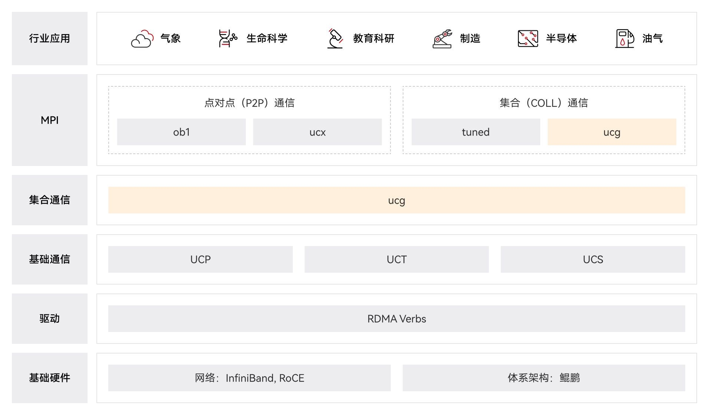
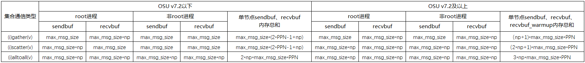

# Hyper MPI 开发指南<a name="ZH-CN_TOPIC_0000001928382709"></a>

-   **[产品描述](#ZH-CN_TOPIC_0000002533293109)**  

-   **[操作指南](#ZH-CN_TOPIC_0000002501373216)**  

-   **[FAQ](#ZH-CN_TOPIC_0000002533293127)**  

-   **[算法地图](#ZH-CN_TOPIC_0000002501373246)**  

-   **[命令参数](#ZH-CN_TOPIC_0000002533333099)**  

-   **[术语&缩略语](#ZH-CN_TOPIC_0000002501373250)**  

## 产品描述<a name="ZH-CN_TOPIC_0000002533293109"></a>

-   **[产品介绍](#ZH-CN_TOPIC_0000002501533062)**  

-   **[软件架构](#ZH-CN_TOPIC_0000002501373210)**  

-   **[关键特性](#ZH-CN_TOPIC_0000002533333063)**  

### 产品介绍<a name="ZH-CN_TOPIC_0000002501533062"></a>

**概念介绍<a name="title3293mcpsimp"></a>**

MPI（Message Passing Interface）是一种支持多语言编程的并行计算通信应用接口规范，它定义了一组函数和语法规则，使得多个进程可以在不同的计算机节点上协同工作，并共同完成一个任务。MPI有多种实现，例如Open MPI、Intel MPI、MPICH等。

Hyper MPI（简称HMPI）是在Open MPI的基础上，结合Open UCX（Unified Communication X）框架的点对点通信操作，开发出专为集合通信优化的UCG（Unified Communication Group）框架，该框架中实现了多种集合操作加速算法。Hyper MPI具有高性能、大规模性、可移植性等特点；支持制造、气象和基因测序等场景解决方案，致力于构建以鲲鹏服务器为坚实硬件基础的高性能计算生态。

Hyper MPI代码已开源，请参见[https://gitcode.com/kunpengcompute/hmpi](https://gitcode.com/kunpengcompute/hmpi)、[https://gitcode.com/kunpengcompute/hucx](https://gitcode.com/kunpengcompute/hucx)、[https://gitcode.com/kunpengcompute/xucg](https://gitcode.com/kunpengcompute/xucg)。

**价值<a name="title3297mcpsimp"></a>**

MPI支持点对点通信和集合通信，可以实现多种通信模式，例如广播、散射、聚集等。其中，仅MPI 3.1标准中定义的集合通信函数就高达30多种。在众多集合通信操作函数中，Allreduce、Bcast、Barrier、Alltoallv、Allgatherv、Gatherv和Scatterv的调用频率较高。

Hyper MPI在集合通信模式中，不管是大包数据，还是小包数据，它的通信性能相较于其它MPI的实现，具有以下优势：

-   高性能优化

    Hyper MPI针对Allreduce、Bcast、Barrier、Alltoallv、Allgatherv、Gatherv、Gather、Scatterv、reduce\_scatter和reduce\_scatter\_block集合通信函数实现基于拓扑感知的算法优化（包括非阻塞接口），并支持集合通信异步硬件卸载。Hyper MPI相较于开源OpenMPI，集合通信性能有较高提升。

-   构筑自由生态

    Hyper MPI开源发布，专为以鲲鹏芯片为核心构建的服务器与大规模集群量身打造。鲲鹏服务器凭借单节点核数众多、指令集设计精简、能耗效率卓越以及极具竞争力的价格优势，与Hyper MPI相辅相成，共同构筑起一个高效、经济的高性能计算生态。

**功能<a name="title3306mcpsimp"></a>**

-   Hyper MPI支持MPI 3.1标准，主要优化的集合通信操作如[表1](#_table8270659113516)所示。

> **说明：** 
>Hyper MPI集合通信算法支持最大发送数据包长度为2<sup>32</sup>字节。

**表 1**  集合通信操作说明

|集合操作名称|函数简介|阻塞接口函数原型|非阻塞接口函数原型|
|--|--|--|--|
|Allreduce|Allreduce是MPI组规约函数。作用：将各个独立进程中的send buffer进行数学（例如加法、乘法）或逻辑（例如与、或）运算，然后将结果同步到通信域内所有进程的receive buffer中。|int MPI_Allreduce(void *sendbuf, void *recvbuf, int count, MPI_Datatype datatype, MPI_Op op, MPI_Comm comm)|int MPI_Iallreduce(const void *sendbuf, void *recvbuf, int count, MPI_Datatype datatype, MPI_Op op, MPI_Comm comm, MPI_Request *request)|
|Bcast|Bcast是MPI广播操作函数。作用：root进程将buffer中的信息发送给通信域内其余进程，使得所有进程获取相同的信息。|int MPI_Bcast(void *buffer, int count, MPI_Datatype datatype, int root, MPI_Comm comm)|int MPI_Ibcast(void *buffer, int count, MPI_Datatype datatype, int root, MPI_Comm comm, MPI_Request *request)|
|Barrier|Barrier是MPI同步函数。作用：该通信域中全部进程进行同步操作，即保证进程调用函数后具有良好的同步性。|int MPI_Barrier(MPI_Comm comm)|int MPI_Ibarrier(MPI_Comm comm, MPI_Request *request)|
|Alltoallv|Alltoallv是MPI多对多通信函数。作用：该通信域中全部进程进行点对点通信操作，发送数据至其他进程，并从其他进程接收数据，且通信中每个进程发送和接收的长度可变。|int MPI_Alltoallv(const void *sendbuf, const int sendcounts[], const int sdispls[], MPI_Datatype sendtype, void *recvbuf, const int recvcounts[], const int rdispls[], MPI_Datatype recvtype, MPI_Comm comm)|int MPI_Ialltoallv(const void *sendbuf, const int sendcounts[], const int sdispls[], MPI_Datatype sendtype, void *recvbuf, const int recvcounts[], const int rdispls[], MPI_Datatype recvtype, MPI_Comm comm, MPI_Request *request)|
|Allgatherv|Allgatherv是MPI数据收集函数。作用：收集该通信域中每个进程可变的数据，并将收集的数据传送给该通信域中的所有进程。|int MPI_Allgatherv(const void *sendbuf, int sendcount, MPI_Datatype sendtype, void *recvbuf, const int recvcounts[], const int displs[], MPI_Datatype recvtype, MPI_Comm comm)|int MPI_Iallgatherv(const void *sendbuf, int sendcount, MPI_Datatype sendtype, void *recvbuf, const int recvcounts[], const int displs[], MPI_Datatype recvtype, MPI_Comm comm, MPI_Request *request)|
|Scatterv|Scatterv是MPI数据分发函数。作用：该通信域中根进程将不同的数据块分发给该通信域中不同的进程。|int MPI_Scatterv(const void *sendbuf, const int sendcounts[], const int displs[], MPI_Datatype sendtype, void *recvbuf, int recvcount, MPI_Datatype recvtype, int root, MPI_Comm comm)|int MPI_Iscatterv(const void *sendbuf, const int sendcounts[], const int displs[], MPI_Datatype sendtype, void *recvbuf, int recvcount, MPI_Datatype recvtype, int root, MPI_Comm comm, MPI_Request *request)|
|Gatherv|Gatherv是MPI数据收集函数。作用：收集该通信域中每个进程可变的数据。|int MPI_Gatherv(const void *sendbuf, int sendcount, MPI_Datatype sendtype,                 void *recvbuf, const int *recvcounts, const int *displs,                 MPI_Datatype recvtype, int root, MPI_Comm comm)|int MPI_Igatherv(const void *sendbuf, int sendcount, MPI_Datatype sendtype, void *recvbuf,                  const int recvcounts[], const int displs[], MPI_Datatype recvtype, int root,                  MPI_Comm comm, MPI_Request *request)|
|Gather|Gatherv是MPI数据收集函数。作用：收集该通信域中每个进程不变的数据。|int MPI_Gather(const void *sendbuf, int sendcount, MPI_Datatype sendtype,                 void *recvbuf, int recvcount, MPI_Datatype recvtype, int root, MPI_Comm comm)|int MPI_Igather(const void *sendbuf, int sendcount, MPI_Datatype sendtype, void *recvbuf, int recvcount, MPI_Datatype recvtype, int root, MPI_Comm comm, MPI_Request *request)|
|Reduce_scatter|Reduce_scatter是MPI组规约和分发函数。作用：将各个独立进程中的send buffer进行数学（例如加法、乘法）或逻辑（例如与、或）运算，然后将不同的数据结果分发给不同的进程，不同进程拿到的数据个数可以不一样。|int MPI_Reduce_scatter(const void *sendbuf, void *recvbuf, const int* recvcounts[], MPI_Datatype datatype, MPI_Op op, MPI_Comm comm)|int MPI_Ireduce_scatter(const void *sendbuf, void *recvbuf, const int* recvcounts[], MPI_Datatype datatype, MPI_Op op, MPI_Comm comm, MPI_Request *request)|
|Reduce_scatter_block|Reduce_scatter_block是MPI组规约和分发函数。作用：将各个独立进程中的send buffer进行数学（例如加法、乘法）或逻辑（例如与、或）运算，然后将不同的数据结果分发给不同的进程，不同进程拿到的数据个数一样。|int MPI_Reduce_scatter_block(const void *sendbuf, void *recvbuf, int recvcount, MPI_Datatype datatype, MPI_Op op, MPI_Comm comm)|int MPI_Ireduce_scatter_block(const void *sendbuf, void *recvbuf, int recvcount, MPI_Datatype datatype, MPI_Op op, MPI_Comm comm, MPI_Request *request)|


-   Hyper MPI支持Singularity容器化，即能够部署在Singularity容器中。

### 软件架构<a name="ZH-CN_TOPIC_0000002501373210"></a>

Hyper MPI基于Open MPI的MCA（Modular Component Architecture）框架和Open UCX的分层结构，进行自定义组件的新增和优化。

-   与Open MPI相似之处：

    Hyper MPI包含两个软件层：UCX和OMPI层，即HUCX（Hyper Unified Communication X）和Hyper MPI。

-   与Open MPI不同之处：

    Open MPI采用P2P方式，Hyper MPI在UCX框架基础上增加集合通信模块XUCG（X Unified Communication Group）。该模块南向接口直接依赖于传输层UCT（Unified Communication Transport）和协议层UCP（Unified Communication Protocol），北向接口支持Open MPI的MCA框架中的集合操作组件。

Hyper MPI的软件架构如[图1](#_fig1346311476342)所示。

**图 1** Hyper MPI软件架构<a name="_fig1346311476342"></a>  


Hyper MPI的软件架构中各模块说明如[表1](#_d1e365)所示。

**表 1** Hyper MPI软件架构中各模块说明

|软件层|模块名称|用途|
|--|--|--|
|Hyper MPI|P2P|MCA框架中的点对点操作组件。|
|Hyper MPI|COLL|MCA框架中的集合操作组件。|
|XUCG|UCG|集合通信模块，UCX中的新增集合通信组件，包含UCG集合通信框架和UCG算法加速组件。|
|HUCX|UCP|UCP协议层，协议层API，基于UCT构建通用协议的实现，包括MPI、OpenSHMEM、PGAS等。|
|HUCX|UCT|通信传输模块，基于硬件的底层API，提供基本的网络收发操作。|
|HUCX|UCS|通用服务与工具，包含一系列数据结构、算法以及通用的系统工具。|


### 关键特性<a name="ZH-CN_TOPIC_0000002533333063"></a>

Hyper MPI针对Allreduce、Bcast、Barrier、Alltoallv、Allgatherv、Gatherv、Gather、Scatterv、reduce\_scatter和reduce\_scatter\_block的阻塞与非阻塞接口这七种集合操作，进行了算法和拓扑感知层面的优化，达到特定集合通信小包情形下的极致性能。相较于其他MPI，Hyper MPI具有以下关键特性：

-   新增UCG模块

    Hyper MPI除了包含Open MPI的所有特性之外，增加了集合通信模块（UCG），该模块中含有大量自研集合通信算法，大幅度提升Allreduce、Bcast、Barrier、Alltoallv、Allgatherv、Gatherv、Gather、Scatterv、reduce\_scatter和reduce\_scatter\_block的阻塞与非阻塞接口等集合通信函数的性能。该模块还包含部分集合通信接口的硬件卸载算法，大幅提升计算、通信交叠率。

-   新增KuComm组件

    Hyper MPI在hmpi层集合通信coll框架下新增KuComm分层拓扑组件，提供分层次拓扑框架能力，同时提供Bcast/Alltoall的阻塞集合操作接口，其他集合操作及点对点接口复用OpenMPI 4.x提供的功能。该组件为后续不同层级通信域使用各自最适合的集合通信组件，进行极致性能优化提供了良好基础。

-   新增FP16数据类型

    Hyper MPI在hmpi层新增FP16半精度数据类型支持，支持AI4S场景基础加速库的开发。

    在mpi扩展模块中新增c/c++语言的半精度数据类型：MPIX\_SHORT\_FLOAT、MPIX\_C\_SHORT\_FLOAT\_COMPLEX、MPIX\_CXX\_SHORT\_FLOAT\_COMPLEX类型，使用时需要引入<mpi-ext.h\>头文件。当前HPCKit中的编译器不支持Fortran的半精度类型real2和complex4，因此hmpi内部也暂不使能Fortran的半精度特性。

-   支持鲲鹏环境

    Hyper MPI可以在以鲲鹏芯片为核心的服务器和集群上发挥作用。

-   支持动态加载闭源组件

    Hyper MPI开源版本安装后，可以将Hyper MPI闭源组件安装到开源Hyper MPI安装目录进行闭源特性使能，无需重新编译安装Hyper MPI开源版本，Hyper MPI闭源组件提供进一步的优化特性。

## 操作指南<a name="ZH-CN_TOPIC_0000002501373216"></a>

-   **[提交MPI作业](#ZH-CN_TOPIC_0000002533333069)**  

-   **[运行MPI作业](#ZH-CN_TOPIC_0000002501533070)**  

-   **[集合操作算法选择说明](#ZH-CN_TOPIC_0000002501373218)**  

-   **[KuComm使用说明](#ZH-CN_TOPIC_0000002501373220)**  

-   **[命令说明及示例](#ZH-CN_TOPIC_0000002533333073)**  

### 提交MPI作业<a name="ZH-CN_TOPIC_0000002533333069"></a>

Hyper MPI并行作业的调度，通过配置Linux的SSH免密登录直接运行**mpirun**命令进行提交。

### 运行MPI作业<a name="ZH-CN_TOPIC_0000002501533070"></a>

本文介绍运行MPI作业的方法。

**背景信息<a name="title5618mcpsimp"></a>**

Hyper MPI支持的集合操作包含Allreduce、Bcast、Barrier、Alltoallv、Allgatherv、Gatherv和Scatterv。Hyper MPI支持如下算法模式。

-   默认算法模式：使用coll-ucg模块运行MPI作业，在运行作业时不需要添加“--mca coll ^ucg”参数。
-   指定算法模式：使用Open MPI原有的集合通信方式运行MPI作业，在运行作业时需要添加“--mca coll ^ucg”参数。

指定算法模式的示例如下：

**mpirun -np** _16_ **-N** _2_ **--hostfile** _hf_ **--mca coll ^ucg** _test\_case_

> **说明：** 
>-   -np：表示所有节点总进程数，计算方式为单节点的进程数量（N）\*节点数量。
>-   -N：表示每个节点的进程数。
>-   --hostfile：表示进程运行节点的配置文件。
>-   test\_case：表示mpicc编译后的二进制文件。

Hyper MPI默认对业务进程按照core的策略进行绑核，如果业务进程为多线程程序，为保障线程的正常调度，需要根据业务线程规模手动修改绑核配置，例如：

-   可以通过指定rankfile文件的方式实现细粒度绑核，rankfile文件的编写规则为：

    **rank** _0_=\{_ip1_\}  **slot=**_0_-_7_

    **rank** _1_=\{_ip2_\}  **slot=**_0_-_7_

    上述规则表示将MPI的0号任务绑定在ip1节点的0-7号CPU核上；将MPI的1号任务绑定在ip2节点的0-7号CPU核上。

    运行命令示例如下：

    **mpirun --rankfile** _rf_ _test\_case_

> **说明：** 
>--rankfile配置项无法与--hostfile或-N选项同时使用。

-   可以通过配置**--bind-to core**或**--bind-to** **numa**或**--bind-to** **socket**实现粗粒度绑核。运行命令示例如下：

    **mpirun -np** _2_ **-N** _1_ **--hostfile** _hf_ **--bind-to** _numa_ _test\_case_

**通过默认算法运行MPI作业<a name="title5685mcpsimp"></a>**

Hyper MPI在默认情况下根据包长、每个节点的进程数（PPN）和节点数三个参数选择算法，在使用时直接运行**mpirun**命令即可，无需添加额外参数。

-   Allreduce、Bcast和Allgatherv集合操作默认算法根据包长、PPN和节点数三个参数进行选择。
-   Barrier、Gatherv和Scatterv集合操作默认算法根据PPN和节点数进行选择。
-   Alltoallv集合操作默认算法是Ladd。

运行命令示例如下：

**mpirun -np** _16_ **-N** _2_ **--hostfile** _hf_ **test\_case**

> **说明：** 
>Hyper MPI中并非每一个算法都支持所有的场景，在一些不支持场景下，会回退至支持的算法，详情请参见[特性支持与功能回退说明](#ZH-CN_TOPIC_0000002501533072)。

**通过指定算法运行MPI作业<a name="title5707mcpsimp"></a>**

以Allreduce的算法参数**UCG\_PLANC\_UCX\_**_ALLREDUCE_**\_ATTR**为例进行介绍。通过指定算法运行MPI作业的命令参数请参见[指定算法支持的命令参数](#section12907174313112)。

-   方法一：通过命令行参数指定算法
    1.  使用PuTTY工具，以Hyper MPI普通用户（例如“hmpi\_user”）登录至作业执行节点。
    2.  在**mpirun**命令中增加如下参数。

        **-x UCG\_PLANC\_UCX\_**_ALLREDUCE_**\_ATTR=I:**_id_\[**S:**_score_**R:**_start_-_end_\]

-   方法二：通过设置环境变量的方式来选择对应的算法
    1.  使用PuTTY工具，以Hyper MPI普通用户（例如“hmpi\_user”）登录至作业执行节点。
    2.  将以下命令写入所有节点的“\~/.bashrc”中。

        **export UCG\_PLANC\_UCX\_**_ALLREDUCE_**\_ATTR=I:**_id_\[**S:**_score_**R:**_start_-_end_\]

        > **说明：** 
        >-   id：表示对应算法的序号。对应算法的序号请参见[算法地图](#ZH-CN_TOPIC_0000002501373246)。如果算法选择的数值不在有效范围内，则会执行默认算法。
        >-   score：表示算法分数，分数越高，算法优先级越高。如果不指定，默认该算法优先级最高。取值为任意自然数。
        >-   start-end：表示算法适用的包大小范围。如果不指定，默认该算法适用于所有包大小。start、end的取值为任意自然数。

    3.  执行以下命令，使环境变量生效。

        **source \~/.bashrc**

    4.  不再需要该环境变量时，需执行以下操作。

        删除“\~/.bashrc”中已写入的“**export UCG\_PLANC\_UCX\_**_ALLREDUCE_**\_ATTR=I:**_id_\[**S:**_score_**R:**_start_-_end_\]”命令。

        执行以下命令，删除已生效的环境变量。

        **unset UCG\_PLANC\_UCX\_**_ALLREDUCE_**\_ATTR**

**指定算法支持的命令参数<a name="section12907174313112"></a>**

-   Hyper MPI兼容Open MPI的命令参数

    具体请参见[https://www.open-mpi.org/doc/current/man1/mpirun.1.php](https://www.open-mpi.org/doc/current/man1/mpirun.1.php)。

-   Hyper MPI新增的命令参数

    [表1](#_d1e3438)中为运行MPI作业时的常用命令参数，更多命令参数请参见[命令参数](#ZH-CN_TOPIC_0000002533333099)。

    **表 1**  指定算法支持的常用命令参数

|Hyper MPI命令参数|取值|**参数说明**|
|--|--|--|
|-x UCG_PLANC_UCX_BCAST_ATTR=|取值类型：string，格式为I:*id*[S:*score*R:*start*-*end*]。取值范围：id：必填，1~4, 6, 8~14。score：选填，任意自然数。start：选填，任意自然数。end：选填，任意自然数。默认值：无固定值，根据生效规则调节赋值。|可选参数，Bcast的算法参数。示例：**-x UCG_PLANC_UCX_BCAST_ATTR=I:4**|
|-x UCG_PLANC_UCX_ALLREDUCE_ATTR=|取值类型：string，格式为I:*id*[S:*score*R:*start*-*end*]。取值范围：id：必填，1~8,11~14。score：选填，任意自然数。start：选填，任意自然数。end：选填，任意自然数。默认值：无固定值，根据生效规则调节赋值。|可选参数，Allreduce的算法参数。示例：**-x UCG_PLANC_UCX_ALLREDUCE_ATTR=I:7**|
|-x UCG_PLANC_UCX_BARRIER_ATTR=|取值类型：string，格式为I:*id*[S:*score*R:*start*-*end*]。取值范围：id：必填，1~7,10。score：选填，任意自然数。start：选填，任意自然数。end：选填，任意自然数。默认值：无固定值，根据生效规则调节赋值。|可选参数，Barrier的算法参数。示例：**-x UCG_PLANC_UCX_BARRIER_ATTR=I:1**|
|-x UCG_PLANC_UCX_ALLTOALLV_ATTR=|取值类型：string，格式为I:*id*[S:*score*R:*start*-*end*]。取值范围：id：必填，1~5。score：选填，任意自然数。start：选填，任意自然数。end：选填，任意自然数。默认值：无固定值，根据生效规则调节赋值。|可选参数，Alltoallv的算法参数。示例：**-x UCG_PLANC_UCX_ALLTOALLV_ATTR=I:1**|
|-x UCG_PLANC_UCX_ALLGATHERV_ATTR=|取值类型：string，格式为I:*id*[S:*score*R:*start*-*end*]。取值范围：id：必填，1~6。score：选填，任意自然数。start：选填，任意自然数。end：选填，任意自然数。默认值：无固定值，根据生效规则调节赋值。|可选参数，Allgatherv的算法参数。示例：**-x UCG_PLANC_UCX_ALLGATHERV_ATTR=I:3**|
|-x UCG_PLANC_UCX_SCATTERV_ATTR=|取值类型：string，格式为I:*id*[S:*score*R:*start*-*end*]。取值范围：id：必填，1~3。score：选填，任意自然数。start：选填，任意自然数。end：选填，任意自然数。默认值：无固定值，根据生效规则调节赋值。|可选参数，Scatterv的算法参数。示例：**-x UCG_PLANC_UCX_SCATTERV_ATTR=I:1**|
|-x UCG_PLANC_UCX_GATHERV_ATTR=|取值类型：string，格式为I:*id*[S:*score*R:*start*-*end*]。取值范围：id：必填，1~4。score：选填，任意自然数。start：选填，任意自然数。end：选填，任意自然数。默认值：无固定值，根据生效规则调节赋值。|可选参数，Gatherv的算法参数。示例：**-x UCG_PLANC_UCX_GATHERV_ATTR=I:1**|
|-x UCG_PLANC_UCX_GATHER_ATTR=|取值类型：string，格式为I:*id*[S:*score*R:*start*-*end*]。取值范围：id：必填，1~4。score：选填，任意自然数。start：选填，任意自然数。end：选填，任意自然数。默认值：无固定值，根据生效规则调节赋值。|可选参数，Gather的算法参数。示例：**-x UCG_PLANC_UCX_GATHER_ATTR=I:1**|
|-x UCG_PLANC_STARS_BCAST_ATTR=|取值类型：string，格式为I:*id*[S:*score*R:*start*-*end*]。取值范围：id：必填，1~4。score：选填，任意自然数。start：选填，任意自然数。end：选填，任意自然数。默认值：无固定值，根据生效规则调节赋值。|可选参数，Bcast的卸载算法参数。示例：**-x UCG_PLANC_STARS_BCAST_ATTR=I:1**|
|-x UCG_PLANC_STARS_ALLGATHERV_ATTR=|取值类型：string，格式为I:*id*[S:*score*R:*start*-*end*]。取值范围：id：必填，1。score：选填，任意自然数。start：选填，任意自然数。end：选填，任意自然数。默认值：无固定值，根据生效规则调节赋值。|可选参数，Allgatherv的卸载算法参数。示例：**-x UCG_PLANC_STARS_ALLGATHERV_ATTR=I:1**|
|-x UCG_PLANC_STARS_SCATTERV_ATTR=|取值类型：string，格式为I:*id*[S:*score*R:*start*-*end*]。取值范围：id：必填，1。score：选填，任意自然数。start：选填，任意自然数。end：选填，任意自然数。默认值：无固定值，根据生效规则调节赋值。|可选参数，Scatterv的卸载算法参数。示例：**-x UCG_PLANC_STARS_SCATTERV_ATTR=I:1**|
|-x UCG_PLANC_STARS_ALLTOALLV_ATTR=|取值类型：string，格式为I:*id*[S:*score*R:*start*-*end*]。取值范围：id：必填，1。score：选填，任意自然数。start：选填，任意自然数。end：选填，任意自然数。默认值：无固定值，根据生效规则调节赋值。|可选参数，Alltoallv的卸载算法参数。示例：**-x UCG_PLANC_STARS_ALLTOALLV_ATTR=I:1**|
|-x UCG_PLANC_STARS_BARRIER_ATTR=|取值类型：string，格式为I:*id*[S:*score*R:*start*-*end*]。取值范围：id：必填，1。score：选填，任意自然数。start：选填，任意自然数。end：选填，任意自然数。默认值：无固定值，根据生效规则调节赋值。|可选参数，Barrier的卸载算法参数。示例：**-x UCG_PLANC_STARS_BARRIER_ATTR=I:1**|
|-x UCG_PLANC_UCX_IBCAST_ATTR=|取值类型：string，格式为I:*id*[S:*score*R:*start*-*end*]。取值范围：id：必填，1~4, 6, 8~14。score：选填，任意自然数。start：选填，任意自然数。end：选填，任意自然数。默认值：无固定值，根据生效规则调节赋值。|可选参数，IBcast的算法参数。示例：**-x UCG_PLANC_UCX_IBCAST_ATTR=I:4**|
|-x UCG_PLANC_UCX_IALLREDUCE_ATTR=|取值类型：string，格式为I:*id*[S:*score*R:*start*-*end*]。取值范围：id：必填，1~8,11~14。score：选填，任意自然数。start：选填，任意自然数。end：选填，任意自然数。默认值：无固定值，根据生效规则调节赋值。|可选参数，IAllreduce的算法参数。示例：**-x UCG_PLANC_UCX_IALLREDUCE_ATTR=I:7**|
|-x UCG_PLANC_UCX_IBARRIER_ATTR=|取值类型：string，格式为I:*id*[S:*score*R:*start*-*end*]。取值范围：id：必填，1~7,10。score：选填，任意自然数。start：选填，任意自然数。end：选填，任意自然数。默认值：无固定值，根据生效规则调节赋值。|可选参数，IBarrier的算法参数。示例：**-x UCG_PLANC_UCX_IBARRIER_ATTR=I:1**|
|-x UCG_PLANC_UCX_IALLTOALLV_ATTR=|取值类型：string，格式为I:*id*[S:*score*R:*start*-*end*]。取值范围：id：必填，1~5。score：选填，任意自然数。start：选填，任意自然数。end：选填，任意自然数。默认值：无固定值，根据生效规则调节赋值。|可选参数，IAlltoallv的算法参数。示例：**-x UCG_PLANC_UCX_IALLTOALLV_ATTR=I:1**|
|-x UCG_PLANC_UCX_IALLGATHERV_ATTR=|取值类型：string，格式为I:*id*[S:*score*R:*start*-*end*]。取值范围：id：必填，1~6。score：选填，任意自然数。start：选填，任意自然数。end：选填，任意自然数。默认值：无固定值，根据生效规则调节赋值。|可选参数，IAllgatherv的算法参数。示例：**-x UCG_PLANC_UCX_IALLGATHERV_ATTR=I:3**|
|-x UCG_PLANC_UCX_ISCATTERV_ATTR=|取值类型：string，格式为I:*id*[S:*score*R:*start*-*end*]。取值范围：id：必填，1~3。score：选填，任意自然数。start：选填，任意自然数。end：选填，任意自然数。默认值：无固定值，根据生效规则调节赋值。|可选参数，IScatterv的算法参数。示例：**-x UCG_PLANC_UCX_ISCATTERV_ATTR=I:1**|
|-x UCG_PLANC_UCX_IGATHERV_ATTR=|取值类型：string，格式为I:*id*[S:*score*R:*start*-*end*]。取值范围：id：必填，1~4。score：选填，任意自然数。start：选填，任意自然数。end：选填，任意自然数。默认值：无固定值，根据生效规则调节赋值。|可选参数，IGatherv的算法参数。示例：**-x UCG_PLANC_UCX_IGATHERV_ATTR=I:1**|
|-x UCG_PLANC_UCX_IGATHER_ATTR=|取值类型：string，格式为I:*id*[S:*score*R:*start*-*end*]。取值范围：id：必填，1~4。score：选填，任意自然数。start：选填，任意自然数。end：选填，任意自然数。默认值：无固定值，根据生效规则调节赋值。|可选参数，IGather的算法参数。示例：**-x UCG_PLANC_UCX_IGATHER_ATTR=I:1**|
|-x UCG_PLANC_STARS_IBCAST_ATTR=|取值类型：string，格式为I:*id*[S:*score*R:*start*-*end*]。取值范围：id：必填，1~4。score：选填，任意自然数。start：选填，任意自然数。end：选填，任意自然数。默认值：无固定值，根据生效规则调节赋值。|可选参数，IBcast的卸载算法参数。示例：**-x UCG_PLANC_STARS_IBCAST_ATTR=I:1**|
|-x UCG_PLANC_STARS_IALLGATHERV_ATTR=|取值类型：string，格式为I:*id*[S:*score*R:*start*-*end*]。取值范围：id：必填，1。score：选填，任意自然数。start：选填，任意自然数。end：选填，任意自然数。默认值：无固定值，根据生效规则调节赋值。|可选参数，IAllgatherv的卸载算法参数。示例：**-x UCG_PLANC_STARS_IALLGATHERV_ATTR=I:1**|
|-x UCG_PLANC_STARS_ISCATTERV_ATTR=|取值类型：string，格式为I:*id*[S:*score*R:*start*-*end*]。取值范围：id：必填，1。score：选填，任意自然数。start：选填，任意自然数。end：选填，任意自然数。默认值：无固定值，根据生效规则调节赋值。|可选参数，IScatterv的卸载算法参数。示例：**-x UCG_PLANC_STARS_ISCATTERV_ATTR=I:1**|
|-x UCG_PLANC_STARS_IALLTOALLV_ATTR=|取值类型：string，格式为I:*id*[S:*score*R:*start*-*end*]。取值范围：id：必填，1。score：选填，任意自然数。start：选填，任意自然数。end：选填，任意自然数。默认值：无固定值，根据生效规则调节赋值。|可选参数，IAlltoallv的卸载算法参数。示例：**-x UCG_PLANC_STARS_IALLTOALLV_ATTR=I:1**|
|-x UCG_PLANC_STARS_IBARRIER_ATTR=|取值类型：string，格式为I:*id*[S:*score*R:*start*-*end*]。取值范围：id：必填，1。score：选填，任意自然数。start：选填，任意自然数。end：选填，任意自然数。默认值：无固定值，根据生效规则调节赋值。|可选参数，IBarrier的卸载算法参数。示例：**-x UCG_PLANC_STARS_IBARRIER_ATTR=I:1**|
|-x UCG_PLANC_UCX_REDUCE_SCATTER_BLOCK_ATTR=|取值类型：string，格式为I:*id*[S:*score*R:*start*-*end*]。取值范围：id：必填，1~2。score：选填，任意自然数。start：选填，任意自然数。end：选填，任意自然数。默认值：无固定值，根据生效规则调节赋值。|可选参数，Reduce_scatter_block的算法参数。示例：**-x UCG_PLANC_UCX_REDUCE_SCATTER_BLOCK_ATTR=I:1**|
|-x UCG_PLANC_UCX_IREDUCE_SCATTER_BLOCK_ATTR=|取值类型：string，格式为I:*id*[S:*score*R:*start*-*end*]。取值范围：id：必填，1~2。score：选填，任意自然数。start：选填，任意自然数。end：选填，任意自然数。默认值：无固定值，根据生效规则调节赋值。|可选参数，IReduce_scatter_block的算法参数。示例：**-x UCG_PLANC_UCX_IREDUCE_SCATTER_BLOCK_ATTR=I:1**|
|-x UCG_PLANC_UCX_REDUCE_SCATTER_ATTR=|取值类型：string，格式为I:*id*[S:*score*R:*start*-*end*]。取值范围：id：必填，1~2。score：选填，任意自然数。start：选填，任意自然数。end：选填，任意自然数。默认值：无固定值，根据生效规则调节赋值。|可选参数，Reduce_scatter的算法参数。示例：**-x UCG_PLANC_UCX_REDUCE_SCATTER_ATTR=I:1**|
|-x UCG_PLANC_UCX_IREDUCE_SCATTER_ATTR=|取值类型：string，格式为I:*id*[S:*score*R:*start*-*end*]。取值范围：id：必填，1~2。score：选填，任意自然数。start：选填，任意自然数。end：选填，任意自然数。默认值：无固定值，根据生效规则调节赋值。|可选参数，IReduce_scatter的算法参数。示例：**-x UCG_PLANC_UCX_IREDUCE_SCATTER_ATTR=I:1**|


### 集合操作算法选择说明<a name="ZH-CN_TOPIC_0000002501373218"></a>

-   **[指定算法说明](#ZH-CN_TOPIC_0000002533333071)**  

-   **[推荐命令](#ZH-CN_TOPIC_0000002533293119)**  

-   **[特性支持与功能回退说明](#ZH-CN_TOPIC_0000002501533072)**  

#### 指定算法说明<a name="ZH-CN_TOPIC_0000002533333071"></a>

> **说明：** 
>以下算法序号对应的算法内容请参见[算法地图](#ZH-CN_TOPIC_0000002501373246)。

**关于Allreduce指定算法的说明<a name="title4253mcpsimp"></a>**

-   在选用算法13、14时，为保证进程数在Socket上平均分布，需要加上以下选项，命令如下：

    **--map-by-socket --rank-by-core**

-   在选用算法5、6时，节点内采用了K-nomial算法，可通过调节K-nomial tree结构的K值参数值，寻找最优参数值，从而获得最佳性能。K值范围为\(0,进程数\]。示例命令如下：

    **-x UCG\_PLANC\_UCX\_ALLREDUCE\_FANOUT\_INTRA\_DEGREE=**_3_

    **-x UCG\_PLANC\_UCX\_ALLREDUCE\_FANIN\_INTRA\_DEGREE=**_8_

-   在选用算法7、8时，节点内与节点间都采用了K-nomial算法，可通过调节K-nomial tree结构的K值参数值，寻找最优参数值，从而获得最佳性能。K值范围为\(0,进程数\]。示例命令如下：

    **-x UCG\_PLANC\_UCX\_ALLREDUCE\_FANOUT\_INTER\_DEGREE=**_7_ **-x UCG\_PLANC\_UCX\_ALLREDUCE\_FANIN\_INTER\_DEGREE=**_7_ **-x UCG\_PLANC\_UCX\_ALLREDUCE\_FANOUT\_INTRA\_DEGREE=**_3_ **-x UCG\_PLANC\_UCX\_ALLREDUCE\_FANIN\_INTRA\_DEGREE=**_8_

为提高性能，也可加入以下选项，调整传输模式：

**-x UCX\_TLS=sm,rc\_x**

综上，在调用MPI\_Allreduce和MPI\_Iallreduce时运行命令示例如下（鲲鹏芯片）：

**mpirun -np** _16_ **-N** _2_ **--hostfile hf8 -x UCX\_TLS=sm,rc\_x -x UCG\_PLANC\_UCX\_ALLREDUCE\_ATTR=I:**_n_**S:**_200_**R:0- test\_case**

**关于Bcast指定算法的说明<a name="title4290mcpsimp"></a>**

-   在选用算法3时，节点间采用了K-nomial算法，可通过调节K值参数值，寻找最优参数值，从而获得最佳性能。K值范围为\(0,进程数\]。命令示例如下：

    **-x UCG\_PLANC\_UCX\_BCAST\_NA\_KNTREE\_INTER\_DEGREE=**_7_

-   在选用算法4时，节点内与节点间都采用了K-nomial算法，可通过调节K值参数值，寻找最优参数值，从而获得最佳性能。K值范围为\(0,进程数\]。命令示例如下：

    **-x UCG\_PLANC\_UCX\_BCAST\_NA\_KNTREE\_INTER\_DEGREE=**_7_

    **-x UCG\_PLANC\_UCX\_BCAST\_NA\_KNTREE\_INTRA\_DEGREE=**_3_

-   在选用算法9时，可通过以下参数值调整ESBT算法中划分的块数，寻找最优参数值，从而获得最佳性能。默认值为0，表示auto。命令示例如下：

    **-x UCG\_PLANC\_UCX\_BCAST\_ESBT\_BLOCKS=**_3_

    为提高性能，也可加入以下选项（共享内存Shared Memory和基于任意传输的可靠连接），调整传输模式：

**-x UCX\_TLS=sm,rc\_x**

综上，在调用MPI\_Bcast和MPI\_Ibcast时运行命令示例如下（鲲鹏芯片）：

**mpirun -np** _16_ **-N** _2_ **--hostfile hf8 -x UCX\_TLS=sm,rc\_x -x UCG\_PLANC\_UCX\_BCAST\_ATTR=I:**_n_**S:**_200_**R:0- test\_case**

**关于Barrier指定算法的说明<a name="title4322mcpsimp"></a>**

从[算法地图](#ZH-CN_TOPIC_0000002501373246)可知，Barrier的算法是Allreduce算法的子集，因此可参考Allreduce指定算法说明，此处不再赘述。

**关于Alltoallv指定算法的说明<a name="title4327mcpsimp"></a>**

在选用算法1时，可通过调整以下参数值，调整每次的通信请求次数，请根据实际情况替换。命令示例如下：

**-x UCG\_PLANC\_UCX\_ALLTOALLV\_LADD\_THROTTLED\_FACTOR**=_2_

在选用算法5时，需要开启以下参数使能共享内存。命令示例如下：

**-x UCG\_USE\_SHM\_POOL=**y

为提高性能，也可加入以下选项，调整传输模式：

**-x UCX\_TLS=sm,rc\_x**

综上，在调用MPI\_Alltoallv和MPI\_Ialltoallv时运行命令示例如下（鲲鹏芯片）：

**mpirun -np** _16_ **-N** _2_ **--hostfile hf8 -x UCX\_TLS=sm,rc\_x -x UCG\_PLANC\_UCX\_ALLTOALLV\_ATTR=I:**_n_**S**:_200_**R:0- test\_case**

**关于Scatterv指定算法的说明<a name="title4350mcpsimp"></a>**

-   在选用算法1时，可通过调整以下参数值，寻找最优参数值，从而获得最佳性能。命令示例如下：

    **-x UCG\_PLANC\_UCX\_SCATTERV\_MIN\_SEND\_BATCH=**_7_

    **-x UCG\_PLANC\_UCX\_SCATTERV\_MAX\_SEND\_BATCH**=_8_

-   在选用算法2时，采用了K-nomial算法，可通过调整K值参数值，寻找最优参数值，从而获得最佳性能。命令示例如下：

    **-x UCG\_PLANC\_UCX\_SCATTERV\_KNTREE\_DEGREE=**_3_

-   在选用算法3时，采用了Node-aware K-nomial tree算法，由于节点间和节点内通信都采用了K-nomial算法，可通过调整节点间和节点内通信的K值参数值，寻找最优参数值，从而获得最佳性能。命令示例如下：

    **-x UCG\_PLANC\_UCX\_SCATTERV\_NA\_KNTREE\_INTER\_DEGREE=**_4_

    **-x UCG\_PLANC\_UCX\_SCATTERV\_NA\_KNTREE\_INTRA\_DEGREE=**_3_

> **说明：** 
>-   Scatterv操作的算法3在数据量较小的场景下性能较优，数据量大的场景下性能较差。
>-   由于Scatterv操作无法根据数据量的大小自动选择最优算法，建议在数据量较小的场景下使用算法3。

为提高性能，也可加入以下选项，调整传输模式：

**-x UCX\_TLS=sm,rc\_x**

综上，在调用MPI\_Scatterv和MPI\_Iscatterv时运行命令示例如下（鲲鹏芯片）：

**mpirun -np** _16_ **-N** _2_ **--hostfile hf8 -x UCX\_TLS=sm,rc\_x -x UCG\_PLANC\_UCX\_SCATTERV\_ATTR=I:**_n_**S:**_200_**R:0- test\_case**

**关于Allgatherv指定算法的说明<a name="title4391mcpsimp"></a>**

为提高性能，可加入以下选项，调整传输模式：

**-x UCX\_TLS=sm,rc\_x**

综上，在调用MPI\_Allgatherv和MPI\_Iallgatherv时运行命令示例如下（鲲鹏芯片）：

**mpirun -np** _16_ **-N** _2_ **--hostfile hf8 -x UCX\_TLS=sm,rc\_x -x UCG\_PLANC\_UCX\_ALLGATHERV\_ATTR=I:**_n_**S:**_200_**R:0- test\_case**

**关于Gather指定算法的说明<a name="section7368015105810"></a>**

-   在选用算法3时，采用了K-nomial算法，可通过调整K值参数值，寻找最优参数值，从而获得最佳性能。命令示例如下：

    **-x UCG\_PLANC\_UCX\_GATHER\_KNTREE\_DEGREE=**_3_

-   在选用算法4时，采用了Node-aware K-nomial tree算法，由于节点间和节点内通信都采用了K-nomial算法，可通过调整节点间和节点内通信的K值参数值，寻找最优参数值，从而获得最佳性能。命令示例如下：

    **-x UCG\_PLANC\_UCX\_GATHER\_NA\_KNTREE\_INTER\_DEGREE=**_4_

    **-x UCG\_PLANC\_UCX\_GATHER\_NA\_KNTREE\_INTRA\_DEGREE=**_3_

**关于Gatherv指定算法的说明<a name="title4407mcpsimp"></a>**

-   在选用算法3时，采用了K-nomial算法，可通过调整K值参数值，寻找最优参数值，从而获得最佳性能。命令示例如下：

    **-x UCG\_PLANC\_UCX\_GATHERV\_KNTREE\_DEGREE=**_3_

-   在选用算法4时，采用了Node-aware K-nomial tree算法，由于节点间和节点内通信都采用了K-nomial算法，可通过调整节点间和节点内通信的K值参数值，寻找最优参数值，从而获得最佳性能。命令示例如下：

    **-x UCG\_PLANC\_UCX\_GATHERV\_NA\_KNTREE\_INTER\_DEGREE=**_4_

    **-x UCG\_PLANC\_UCX\_GATHERV\_NA\_KNTREE\_INTRA\_DEGREE=**_3_

#### 推荐命令<a name="ZH-CN_TOPIC_0000002533293119"></a>

在调用Hyper MPI运行应用时，可能会同时调用Allreduce、Bcast、Barrier、Alltoallv、Allgatherv、Gatherv和Scatterv操作，此时的推荐算法命令示例如下（鲲鹏芯片）：

**mpirun -np** _16_ **-N** _2_ **--hostfile hf --map-by socket --rank-by core --bind-to core -x UCX\_TLS=sm,rc\_x -x UCG\_PLANC\_UCX\_BCAST\_ATTR=I:**_3_ **-x UCG\_PLANC\_UCX\_ALLREDUCE\_ATTR=I:**_6_ **-x UCG\_PLANC\_UCX\_BARRIER\_ATTR=I:**_5_**S:**_200_**R:**_0_ **-x UCG\_PLANC\_UCX\_ALLGATHERV\_ATTR=I:**_5_**S:**_200_**R:**_0_ **-x UCG\_PLANC\_UCX\_GATHERV\_ATTR=I:**_2_ **-x UCG\_PLANC\_UCX\_SCATTERV\_ATTR=I:**_1_ **-x UCG\_PLANC\_UCX\_ALLTOALLV\_ATTR=I:**_1_ **test\_case**

#### 特性支持与功能回退说明<a name="ZH-CN_TOPIC_0000002501533072"></a>

Hyper MPI中并非每一个算法都支持所有的场景，以下几种场景属于部分算法支持。

**场景一：节点进程不均衡（即PPN不均衡）<a name="title6357mcpsimp"></a>**

PPN：Processes Per Node，每节点进程数。

使用**mpirun**命令提交任务不指定PPN或者使用rankfile等情况下，会出现节点进程不均衡的场景，当指定Hyper MPI中Allreduce算法11、13、14，Allgatherv算法6，Scatterv算法3，Barrier算法10，Alltoallv算法2时，会自动回退至支持的算法。

**场景二：Socket进程不均衡（即PPS不均衡）<a name="title6362mcpsimp"></a>**

PPS：Processes Per Socket，每CPU插槽进程数。

使用**mpirun**命令提交任务不指定PPS或者使用rankfile等情况下，会出现Socket进程不均衡的场景，当指定Hyper MPI中Allreduce算法13、14时，会自动回退至支持的算法。

**场景三：非对易操作<a name="title6367mcpsimp"></a>**

MPI标准支持用户在Allreduce内进行自定义数学操作，即不局限于求和（MPI\_SUM）、乘积（MPI\_PROD）等MPI内置的数学操作；用户在自定义数学操作时会出现操作本身不对易的情况，如矩阵乘法。Allreduce算法1支持此类操作。

当用户指定算法不是算法1时，Hyper MPI会根据数据包大小回退成算法1（中小包）。

**场景四：指定--bind-to none或者--bind-to board<a name="title6371mcpsimp"></a>**

当MPI指定--bind-to为none或者board时，Allreduce算法3、6、8、13、14和Barrier算法3、5、7不支持此场景，会自动回退至支持的算法。

**场景五：发送的数量count小于所有节点总进程数np或所有节点进程数减一<a name="title6374mcpsimp"></a>**

总进程数np即通过mpirun -np参数指定的所有MPI进程的总数。其计算逻辑为：np = 节点数 × PPN。

当发送的数量count小于所有节点进程数np时，Allreduce算法4、12、13、14和Bcast算法8、11不支持此场景，会自动回退至支持的算法。

当发送的数量count小于所有节点进程数减一（np-1）时，Bcast算法14和Bcast卸载算法3、4不支持此场景，会自动回退至支持的算法。

**场景六：发送的数量count对ppn取余不等于0<a name="title6379mcpsimp"></a>**

当发送的数量count对ppn取余不等于0时，Allreduce算法13不支持此场景，会自动回退至支持的算法。

**场景七：PPS为1<a name="title6382mcpsimp"></a>**

当PPS=1时，Allreduce算法14不支持此场景，会自动回退至支持的算法。

**场景八：PPN为1<a name="title6385mcpsimp"></a>**

当PPN=1时，Allreduce算法11、13、14，Allgatherv算法6，Scatterv算法3，Barrier算法10，Alltoallv算法2不支持此场景，会自动回退至支持的算法。

**场景九：np不为二的N次方<a name="title6388mcpsimp"></a>**

当np不为二的N次方时，Allreduce算法11，Barrier算法10不支持此场景，会自动回退至支持的算法。

**场景十：np为奇数<a name="title6391mcpsimp"></a>**

当np为奇数时，Hyper MPI中Allgatherv算法1不支持此场景，会自动回退至支持的算法。

**场景十一：指定--rank-by node或者--rank-by board<a name="title6394mcpsimp"></a>**

当MPI指定--rank-by node或者--rank-by board时，Alltoallv算法2和Scatterv算法3不支持此场景，将自动回退至支持的算法。

**场景十二：节点数为1<a name="title6397mcpsimp"></a>**

当节点数为1时，Hyper MPI中Alltoallv算法2、Allgatherv算法6和Scatterv算法3不支持此场景，将自动回退至支持的算法。

**场景十三：sendbuf为MPI\_IN\_PLACE<a name="title6400mcpsimp"></a>**

当sendbuf为MPI\_IN\_PLACE时，Hyper MPI中Alltoallv所有算法和Scatterv算法3不支持此场景，回退到Open MPI。

**场景十四：Alltoallv集合操作send或recv total size超过2^32 - 1<a name="title6403mcpsimp"></a>**

此场景下，Hyper MPI中Alltoallv算法2（node-aware plummer）由于是运行时数据，无法在回退时给出判断，会在运行时报错，并给出提示“Alltoallv node-aware plummer don't support datasize \>= 2^32 bytes”。

**场景十五：Alltoallv集合操作节点内所有进程sendcounts总和超过2^31<a name="section157041038112412"></a>**

此场景下，Hyper MPI中Alltoallv算法2（node-aware plummer）由于是运行时数据，无法在回退时给出判断，会在运行时报错，并给出提示“Alltoallv node-aware plummer gatherv phase don't support displs \>= 2^31 bytes”，sendcounts总和计算公式如下：


其中，p为总进程数；ppn为每节点进程数；sendcounts\[i\]为节点内第i个进程的sendcounts数组。

**场景十六：Alltoallv集合操作各进程sendcounts和recvcounts大小不一致<a name="title6411mcpsimp"></a>**

此场景下，若命令参数中不指定Alltoallv的具体算法，可能会出现不同进程回退到不同算法的情况，导致程序无法正常运行。在确保各进程sendcounts和recvcounts大小一致的情况下，可以不指定Alltoallv的具体算法，默认选择性能最优算法。

**场景十七：进程数小于3<a name="title6414mcpsimp"></a>**

当进程数小于3时，Bcast卸载算法1不支持此场景，将自动回退至支持的算法。

**场景十八：进程数小于4<a name="title6417mcpsimp"></a>**

当进程数小于4时，Bcast卸载算法2不支持此场景，将自动回退至支持的算法。

**场景十九：Alltoallv plummer-opt算法没开启USE\_SHM\_POOL特性<a name="section33801938165614"></a>**

当指定plummer-opt算法时，未设置UCG\_USE\_SHM\_POOL为y，将自动回退至支持的算法。

### KuComm使用说明<a name="ZH-CN_TOPIC_0000002501373220"></a>

Hyper MPI在HMPI层集合通信coll框架下新增KuComm分层拓扑组件，提供分层次拓扑框架能力。该框架的核心是根据集群的物理硬件拓扑（节点 - Socket - Core）进行分层，旨在为不同层级（如节点间、节点内、Socket内）的通信域，选择并执行最适合、性能最高的集合通信算法。

当前版本提供Bcast/Alltoall的阻塞集合操作接口，其他集合操作及点对点接口复用Hyper MPI原有的功能。该组件为后续不同层级通信域使用各自最适合的集合通信组件，进行极致性能优化提供了良好基础。

**组件使能方式<a name="title2670mcpsimp"></a>**

通过在mpirun命令中添加 --mca coll\_kucomm\_priority 100 将KuComm组件的优先级设为100（高于其他所有集合通信组件的默认优先级），即可使能KuComm组件。

**命令示例<a name="title2673mcpsimp"></a>**

以4节点，每个节点4进程为例

-   使能KuComm前：

    mpirun -np 16 -N 4 --hostfile hf4 -x UCX\_TLS=sm,rc osu\_bcast

-   使能KuComm后：

    mpirun  -np 16 -N 4 --hostfile hf4 -x UCX\_TLS=sm,rc  **--mca coll\_kucomm\_priority 100**  osu\_bcast

**特性支持与回退条件<a name="title2682mcpsimp"></a>**

-   当前KuComm组件仅支持Bcast和Alltoall接口，其他接口不会进入KuComm组件。
-   当前KuComm组件仅支持单线程场景调用Bcast和Alltoall接口。
-   当前KuComm组件仅支持多节点进程分布均匀的场景调用Bcast和Alltoall接口，否则会自动回退到Hyper MPI原有的Bcast和Alltoall接口。
-   当前KuComm组件暂不支持单节点Alltoall接口的调用，会自动回退到Hyper MPI原有的Alltoall接口。

### 命令说明及示例<a name="ZH-CN_TOPIC_0000002533333073"></a>

-   **[传输模式选择说明](#ZH-CN_TOPIC_0000002533293121)**  

-   **[进程分布](#ZH-CN_TOPIC_0000002501533074)**  

-   **[关闭OOB功能](#ZH-CN_TOPIC_0000002533333075)**  

-   **[多网络平面场景使用说明](#ZH-CN_TOPIC_0000002533293123)**  

-   **[HUCX RC多网口容错](#ZH-CN_TOPIC_0000002501533076)**  

-   **[启动时延优化](#ZH-CN_TOPIC_0000002501373224)**  

-   **[命令示例](#ZH-CN_TOPIC_0000002533333077)**  

-   **[SDMA使用场景说明](#ZH-CN_TOPIC_0000002533293125)**  

-   **[Stars使用场景说明](#ZH-CN_TOPIC_0000002501533078)**  

-   **[MPI超时日志分析脚本使用说明](#ZH-CN_TOPIC_0000002501373226)**  

#### 传输模式选择说明<a name="ZH-CN_TOPIC_0000002533293121"></a>

执行以下命令，可查看网络设备及支持的传输模式。

**ucx\_info -d**

回显示例：

```
#   Transport: ud_verbs 
#      Device: mlx5_0:1
```

其中，Device表示当前网络设备，Transport表示当前网络设备支持的传输模式，可存在多个支持的传输模式。

启动MPI作业时，可通过“-x UCX\_TLS”参数设置MPI使用的传输模式。目前常用的参数有ud、rc、shm、mm、rc\_x、ud\_x、dc\_x等。其中shm和mm二选一，ud、rc、rc\_x、ud\_x、dc\_x可以选一个或多个。不设置时默认等同于-x UCX\_TLS=all，表示使用当前网络设备支持的所有传输模式。

更多的传输模式以及含义可参见：[https://github.com/openucx/ucx/wiki/UCX-environment-parameters](https://github.com/openucx/ucx/wiki/UCX-environment-parameters)。

由于默认的参数在不指定场景时会出现不是最优的情况，为达到性能最优，可尝试如下参数组合：

-x UCX\_TLS=shm,rc\_x,ud\_x

-x UCX\_TLS=shm,ud\_x

-x UCX\_TLS=shm,dc\_x

建议：Mellanox网卡环境使用ud\_x与shm组合传输模式，鲲鹏RoCE网卡环境使用ud和shm组合的传输模式，原因是ud模式下创建QP的数量远低于rc模式且通信速率较快，鲲鹏RoCE网卡环境不支持ud\_x模式。

#### 进程分布<a name="ZH-CN_TOPIC_0000002501533074"></a>

建议每个MPI任务在不同节点上分布的进程数一致，并增加--bind-to core --map-by socket --rank-by core，使进程在每个节点的Socket上连续均匀的分布，避免算法切换导致性能不达预期。

#### 关闭OOB功能<a name="ZH-CN_TOPIC_0000002533333075"></a>

建议测试Benchmark（例如OSU、GPCNET等）时，在命令行增加-x UCG\_PLANC\_UCX\_USE\_OOB=no，关闭复用OOB（out-of-band）资源功能，以提升Hyper MPI任务的性能。

示例：

**mpirun -np** _16_ **-x UCG\_PLANC\_UCX\_USE\_OOB=no** **osu\_barrier**

#### 多网络平面场景使用说明<a name="ZH-CN_TOPIC_0000002533293123"></a>

如果mpirun命令的运行环境中存在多个不同的网络平面，即UCX模块使用了多个不同网段的网口，则需要在mpirun命令的启动参数中额外增加-x UCX\_RC\_VERBS\_ROCE\_LOCAL\_SUBNET=y和-x UCX\_UD\_VERBS\_ROCE\_LOCAL\_SUBNET=y参数，否则会因网络不通导致下发任务无法继续执行。

示例如下：

**mpirun -np** _16_ **-N** _16_ **-x PATH -x LD\_LIBRARY\_PATH -x UCX\_RC\_VERBS\_ROCE\_LOCAL\_SUBNET=y -x UCX\_UD\_VERBS\_ROCE\_LOCAL\_SUBNET=y -x UCX\_NET\_DEVICES=**_mlx5\_0:1_**,**_mlx5\_1:1_ **osu\_init**

#### HUCX RC多网口容错<a name="ZH-CN_TOPIC_0000002501533076"></a>

Hyper MPI中HUCX实现了RC（Reliably Connected）多网口容错（rc\_failover）功能。该功能使用多个网口，通过自动检测网口异常状态并将业务流量切换至可用网口上实现容错，减少业务因网络组件故障而异常终止的概率。

当前该功能只支持RC连接方式。通过在mpirun命令行中添加如[表1](#_table11934015203915)所示参数来配置该功能。

**表 1**  配置参数

|参数|是否必选|说明|
|--|--|--|
|-x UCX_TLS=rc_f|是|指定传输模式为“rc_f”。|
|-x UCX_MAX_EAGER_RAILS=*2*|是|使用EAGER多轨。EAGER通道通常用于处理小包场景，为双边通信。取值范围为1~4且为整数，默认为1。若要支持该功能，需配置成大于1。取值可根据节点网卡故障率决定，取值越高，可靠性越高。推荐值为2。|
|-x UCX_LOCAL_CONN_SAME_DEV=*y*|是|本节点内是否使用同名网卡建链，可选值为y或n，默认为n。y：本节点内使用同名网卡建链，可缩小故障域。n：本节点内不同进程使用Numa亲和的网卡建链。|
|-x UCX_MAX_RNDV_RAILS=*2*|否|使用RNDV多轨。RNDV通道通常用于处理大包场景，为单边通信。取值范围为2~4且为整数，默认为2。取值可根据节点网卡故障率决定，取值越高，可靠性越高。推荐值为2。|
|-x UCX_MAX_AUX_RAILS=*2*|否|使用AUX多轨建链。HUCX在使用RC连接方式初始化时，会使用AUX链互相交换地址并进行RC的建链，AUX链通常使用UD（Unreliable Datagram）连接；大规模业务初始化建链时间较长，建议使用AUX多轨建链，并增加AUX多轨数量，以降低在初始化建链过程中网口故障对业务的影响。取值范围为1~4且为整数，默认为1。取值可根据节点网卡故障率决定，取值越高，可靠性越高。推荐值为2。|
|-x UCX_AUX_TIMEOUT=3s|否|设置AUX多轨建链超时时间。默认为20s。格式为：-x UCX_AUX_TIMEOUT=*<number>*[s|us|ms|ns]其中<number>为大于0的整数。当集群规模与业务规模较大时，建链时间较长属于正常现象，可根据集群规模与业务规模适当调整该值，以便及时触发容错处理。|
|-x UCX_NET_DEVICES=*mlx5_0:1*,*mlx5_1:1*|否|设置网口的选择范围。默认从全部网口中选择。|


> **说明：** 
>-   在同一业务进程中，HUCX多网口容错只会在选择的网口范围内进行，不会在未指定的网口中进行切换；当选择的网口数高于设置的多轨数量时，会按照多轨数量进行选择网口（部分网口可能未被选中）。
>-   在同一业务进程中，某网口出现故障后，业务流量会被自动切换到其他可用网口；故障网口恢复后，当前业务不会再次选择曾故障网口；新业务进程不受此影响。
>-   当业务进行中某网口出现故障，无其他可用网口可供切换时，业务仍然报错退出。

命令示例如下：

**mpirun -np** _64_ **-N** _32_ **--hostfile hf -x UCX\_TLS=rc\_f -x UCX\_MAX\_EAGER\_RAILS=**_2_ **-x UCX\_LOCAL\_CONN\_SAME\_DEV=**_y_ **-x UCX\_MAX\_AUX\_RAILS=**_2_ **-x UCX\_AUX\_TIMEOUT=3s osu\_bcast**

#### 启动时延优化<a name="ZH-CN_TOPIC_0000002501373224"></a>

通过在mpirun命令行中加入如下参数来优化启动选项：

-   **--mca osc ^ucx**：使用osc（单边通信模块）时不指定ucx。由于ucx的初始化在业务启动流程中耗时较长，大部分集合通信业务中使用pml，很少会用到osc，因此该配置项可以节省一次ucx初始化的时间。
-   **--mca pml ucx**：指定pml模块只初始化ucx，减少其他模块初始化对启动时延的影响。
-   **--mca oob\_tcp\_if\_include** _网卡名称_：为加快业务启动osu\_init时的fence流程，建议使用TCP带宽较大、时延更优的网卡，因为fence需要节点间发送TCP数据，带外TCP通信网卡往往会成为业务初始化的性能瓶颈。默认使用环境上获取到的第一张网卡，如有性能更好的其他网卡，可以通过该启动选项，提高通信时延性能。
-   **-x UCX\_TLS=sm,rc\_v**：传输层选择sm + rc\_v的组合方式。
    -   sm表示节点内使用sm共享内存作为传输层，这加快了节点内进程的通信传输。
    -   由于rc要初始化rc\_v、ud\_v、rc\_mlx和ud\_mlx，而rc\_v只需初始化rc\_v和ud\_v，因此节点间选择rc\_v，可以加快业务启动时延。

-   **-x UCX\_NET\_DEVICES**=_网卡名称_：选择的网卡数量会影响ud\_v的初始化时延。对于每个网卡设备的初始化，需获取该设备的全部gid\_attr，该过程较为耗时，因此建议减少网卡数量的选择。

启动时延优化命令示例：

**mpirun --mca osc ^ucx --mca pml ucx -np** _32_ **-x UCX\_TLS=sm,rc\_v --hostfile file -x UCX\_NET\_DEVICES=**_mlx5\_0:1_ **--mca oob\_tcp\_if\_include** _enp125s0f0_ **-x PATH -x LD\_LIBRARY\_PATH osu\_init**

#### 命令示例<a name="ZH-CN_TOPIC_0000002533333077"></a>

Hyper MPI使用MPI\_Allreduce算法6、MPI\_Barrier算法5和MPI\_Bcast算法3能获得较优的性能指标。

-   IB网络环境命令示例

    **mpirun -np** _384_ **-N** _48_ **--hostfile hf --bind-to core --map-by socket --rank-by core --mca btl ^vader,tcp,openib -x UCX\_TLS=sm,ud\_x -x UCX\_NET\_DEVICES=**_mlx5\_0:1_ **-x UCG\_PLANC\_UCX\_ALLREDUCE\_ATTR=I:**_6_**S:**_200_**R:**_0-_ **-x UCG\_PLANC\_UCX\_BARRIER\_ATTR=I:**_5_**S:**_200_**R:**_0_ **-x UCG\_PLANC\_UCX\_BCAST\_ATTR=I:**_3_**S:**_200_**R:**_0-_ **-x UCG\_PLANC\_UCX\_ALLREDUCE\_FANOUT\_INTRA\_DEGREE=**_3_ **-x UCG\_PLANC\_UCX\_ALLREDUCE\_FANIN\_INTRA\_DEGREE=**_2_ **-x UCG\_PLANC\_UCX\_ALLREDUCE\_FANOUT\_INTER\_DEGREE=**_7_ **-x UCG\_PLANC\_UCX\_ALLREDUCE\_FANIN\_INTER\_DEGREE=**_7_ **-x UCG\_PLANC\_UCX\_BARRIER\_FANOUT\_INTRA\_DEGREE=**_3_ **-x UCG\_PLANC\_UCX\_BARRIER\_FANIN\_INTRA\_DEGREE=**_2_ **-x UCG\_PLANC\_UCX\_BARRIER\_FANOUT\_INTER\_DEGREE=**_7_ **-x UCG\_PLANC\_UCX\_BARRIER\_FANIN\_INTER\_DEGREE=**_7_ _test\_case_

-   RoCE网络环境命令示例

    **mpirun -np** _384_ **-N** _48_ **--hostfile hf --bind-to core --map-by socket --rank-by core --mca btl ^vader,tcp,openib -x UCX\_TLS=sm,ud -x UCX\_NET\_DEVICES=**_mlx5\_1:1_ **-x UCG\_PLANC\_UCX\_ALLREDUCE\_ATTR=I:**_6_**S:**_200_**R:**_0-_ **-x UCG\_PLANC\_UCX\_BARRIER\_ATTR=I:**_5_**S:**_200_**R:**_0_ **-x UCG\_PLANC\_UCX\_BCAST\_ATTR=I:**_3_**S:**_200_**R:**_0-_ **-x UCG\_PLANC\_UCX\_ALLREDUCE\_FANOUT\_INTRA\_DEGREE=**_3_ **-x UCG\_PLANC\_UCX\_ALLREDUCE\_FANIN\_INTRA\_DEGREE=**_2_ **-x UCG\_PLANC\_UCX\_ALLREDUCE\_FANOUT\_INTER\_DEGREE=**_7_ **-x UCG\_PLANC\_UCX\_ALLREDUCE\_FANIN\_INTER\_DEGREE=**_7_ **-x UCG\_PLANC\_UCX\_BARRIER\_FANOUT\_INTRA\_DEGREE=**_3_ **-x UCG\_PLANC\_UCX\_BARRIER\_FANIN\_INTRA\_DEGREE=**_2_ **-x UCG\_PLANC\_UCX\_BARRIER\_FANOUT\_INTER\_DEGREE=**_7_ **-x UCG\_PLANC\_UCX\_BARRIER\_FANIN\_INTER\_DEGREE=**_7_ _test\_case_

-   RoCE网络环境Stars集合通信卸载命令示例

    **mpirun -np** _384_ **-N** _48_ **--hostfile hf --bind-to core --map-by socket --rank-by core --mca btl ^vader,tcp,openib -x UCX\_TLS=sm,ud -x UCG\_PLANC\_STARS\_TLS=rc\_acc** **-x UCG\_PLANC\_STARS\_RC\_ROCE\_LOCAL\_SUBNET=y** **-x UCG\_PLANC=ucx,stars -x UCX\_UD\_VERBS\_ROCE\_LOCAL\_SUBNET=y -x UCG\_PLANC\_STARS\_IBCAST\_ATTR=I:**_1_**S:**_200_**R:**_0_ **-x UCG\_PLANC\_STARS\_IALLGATHERV\_ATTR=I:**_1_**S:**_200_**R:**_0_ **-x UCG\_PLANC\_STARS\_ISCATTERV\_ATTR=I:**_1_**S:**_200_**R:**_0_ **-x UCG\_PLANC\_STARS\_IALLTOALLV\_ATTR=I:**_1_**S:**_200_**R:**_0_ **-x UCG\_PLANC\_STARS\_IBARRIER\_ATTR=I:**_1_**S:**_200_**R:**_0_ _test\_case_

> **说明：** 
>IB和RoCE两种网络环境均使用鲲鹏服务器架构和Mellanox类型的网卡。

#### SDMA使用场景说明<a name="ZH-CN_TOPIC_0000002533293125"></a>

System Direct memory access（SDMA）是系统中负责数据的高带宽低延迟搬运的模块，是一种分布式分离式的DMA引擎。当前HMPI默认未开启SDMA，若需使用SDMA，需要在mpirun命令的启动参数中显式增加“-x UCX\_TLS=sdma”参数。SDMA需要与posix或sysv同时使用，即“-x UCX\_TLS=posix,sdma”或“-x UCX\_TLS=sysv,sdma”。推荐鲲鹏920 72F系列使用Hyper MPI加SDMA的场景为PPN不大于128。

示例如下：

**mpirun --allow-run-as-root -np** _2_ **-x UCX\_TLS=posix,sdma osu\_bw**

#### Stars使用场景说明<a name="ZH-CN_TOPIC_0000002501533078"></a>

MPI应用使用非阻塞集合通信接口，将通信任务卸载到Stars硬件执行，释放出的CPU资源用于执行其它计算任务，适用于大包通信的场景。推荐鲲鹏920 72F系列使用Hyper MPI加Stars的场景为单通信域进程数不大于1024。编程范式可参考如下示例：

```
MPI_Ibcast(); // 异步集合通信接口,通信任务卸载到Stars硬件执行 
Compute();   // MPI应用插入其他计算任务，通信后台执行 
MPI_Wait();   // 等待通信完成
```

使用Stars时，需要在mpirun命令的启动参数中指定Stars集合通信算法，比如-x UCG\_PLANC\_STARS\_IBCAST\_ATTR=I:\{算法编号\}S，详细示例说明请参见[RoCE网络环境Stars集合通信卸载命令示例](#li12956143113403)。

#### MPI超时日志分析脚本使用说明<a name="ZH-CN_TOPIC_0000002501373226"></a>

HMPI提供了各类卡住问题的超时日志打印来辅助增强定位的能力，通过日志可以区分出发送端和接收端，能够指导进行溯源到根因进程（节点）。超时日志需要通过mpi\_logparser.py来解析。

**表 1**  mpi\_logparser.py脚本入参说明

|参数|是否必选|说明|
|--|--|--|
|-f|-f或-d必须选一个|指定MPI生成的超时日志文件|
|-d|-f或-d必须选一个|指定MPI生成的超时日志目录|
|-o|否|分析脚本重定向日志输出|
|-u|否|最多打印可疑节点的数量|
|-l|否|分析脚本打印日志级别|
|-s|否|跳过gid解析|


使用示例参考:

```
mpi_logparser.py -f output.log
```

## FAQ<a name="ZH-CN_TOPIC_0000002533293127"></a>

-   **[故障处理流程](#ZH-CN_TOPIC_0000002501533080)**  

-   **[作业进程数过大，报错：There are not enough slots available...](#ZH-CN_TOPIC_0000002533333081)**  

-   **[多节点运行mpirun时异常](#ZH-CN_TOPIC_0000002501533082)**  

-   **[多节点运行mpirun时报某个文件无法找到或打开](#ZH-CN_TOPIC_0000002501373230)**  

-   **[运行MPI作业提示网络设备内存无法分配](#ZH-CN_TOPIC_0000002533333083)**  

-   **[指定网卡名称错误，报错：network device '\*\*\*' is not available](#ZH-CN_TOPIC_0000002533293131)**  

-   **[指定网络类型错误，提示指定的网络类型不可用](#ZH-CN_TOPIC_0000002501533084)**  

-   **[指定主机名错误，报错：Name or service not known](#ZH-CN_TOPIC_0000002501373232)**  

-   **[通信过程建链报错：ucp\_ep\_create\(...\)failed：Destination is unreachable](#ZH-CN_TOPIC_0000002533333085)**  

-   **[在-x UCX\_IB\_GID\_INDEX命令中指定GID后报错](#ZH-CN_TOPIC_0000002533293133)**  

-   **[找不到ARP表项引起的超时报错：ibv\_create\_ah...failed: Connection timed out](#ZH-CN_TOPIC_0000002501533086)**  

-   **[由于网卡配置不当引起的超时报错：connect... failed：Connection timed out](#ZH-CN_TOPIC_0000002501373234)**  

-   **[由于丢包等网络问题造成的UCP request timeout超时报错](#ZH-CN_TOPIC_0000002533333087)**  

-   **[由于丢包等网络原因引起的UD超时报错：UD endpoint ...... unhandled timeout error](#ZH-CN_TOPIC_0000002533293135)**  

-   **[运行报错failed to bind memory，但应用仍可以正常结束](#ZH-CN_TOPIC_0000002501533088)**  

-   **[Allgatherv算法4指定TCP传输，np大规格执行报错](#ZH-CN_TOPIC_0000002533293137)**  

-   **[Allreduce算法8精度问题导致多次执行结果不一致](#ZH-CN_TOPIC_0000002501533090)**  

-   **[超线程环境中rank进程未绑定至逻辑核上](#ZH-CN_TOPIC_0000002501373238)**  

-   **[UCX版本不匹配告警](#ZH-CN_TOPIC_0000002533333091)**  

-   **[UCP请求超时](#ZH-CN_TOPIC_0000002533293139)**  

-   **[运行osu\_alltoall/osu\_alltoallv/osu\_alltoallw/osu\_ialltoall/osu\_ialltoallv/osu\_ialltoallw时出现内存耗尽问题](#ZH-CN_TOPIC_0000002501533092)**  

-   **[运行Alltoallv算法2报错：gatherv phase don't support displs \>= 2^31 bytes](#ZH-CN_TOPIC_0000002501373240)**  

-   **[环境open files值较大时导致Hyper MPI启动慢](#ZH-CN_TOPIC_0000002533333093)**  

-   **[UCX使用SDMA时，报错：UCX ERROR Failed to create sdma\_device\[0\] handle](#ZH-CN_TOPIC_0000002533293141)**  

-   **[运行MPI作业，指定传输协议为RC或者UD时创建qp报错：Invalid argument](#ZH-CN_TOPIC_0000002501533094)**  

-   **[运行MPI作业，指定传输协议为RC或者UD时创建qp报错：No space left on device](#ZH-CN_TOPIC_0000002501373242)**  

-   **[运行MPI作业，并启用Stars集合通信卸载，指定Stars传输协议为rc\_acc时报错：ibv\_wr\_complete fail, ret 12](#ZH-CN_TOPIC_0000002533333095)**  

-   **[运行MPI作业，网卡驱动报错：transport retry counter exceeded](#ZH-CN_TOPIC_0000002533293143)**  

-   **[管理、计算网卡都使用板载网卡并安装RDMA驱动，跑多节点OSU集合通信测试不指定网卡报错](#ZH-CN_TOPIC_0000002501533096)**  

-   **[满核运行集合通信\(i\)osu\_alltoall\(v\)/\(i\)osu\_scatter\(v\)/\(i\)osu\_gather\(v\)节点卡住挂死](#ZH-CN_TOPIC_0000002501373244)**  

-   **[在MPI线程中使用fork方法新建线程，导致运行时报错](#ZH-CN_TOPIC_0000002533333097)**  

### 故障处理流程<a name="ZH-CN_TOPIC_0000002501533080"></a>

Hyper MPI提交任务出现异常或者报错时，可通过“回退法”来定位故障原因，并通过以下步骤进行故障处理。

**操作步骤<a name="title3090mcpsimp"></a>**

1.  切换成默认算法（不指定算法编号）。
    -   如无故障，说明指定算法不支持当前场景，可联系华为技术支持获取帮助。
    -   如仍有故障，执行[步骤2](#d1e6521)。

2.  <a name="d1e6521"></a>屏蔽coll-ucg模块。

    在**mpirun**命令中增加--mca coll ^ucg参数进行提交。如无故障，说明Open MPI支持此场景但Hyper MPI不支持。

    如仍有故障，可能性有两个：

    -   Open MPI本身不支持该场景。
    -   MPI使用方法不当。可从环境变量设置、MPI安装等多方面进行排查，具体故障可参考故障处理其他章节。

### 作业进程数过大，报错：There are not enough slots available...<a name="ZH-CN_TOPIC_0000002533333081"></a>

**现象描述<a name="title3559mcpsimp"></a>**

提交MPI作业的进程数大于集群作业执行节点CPU总核数，导致**mpirun**命令运行失败。

运行失败示例如下：

**mpirun -np 1025 --hostfile hf8 hmpifile\_2021/allreduce/AllReduce**

```
-------------------------------------------------------------------------- 
There are not enough slots available in the system to satisfy the 1025 
slots that were requested by the application: 
  
  hmpifile_2021/allreduce/AllReduce 
  
Either request fewer slots for your application, or make more slots 
available for use. 
  
A "slot" is the Open MPI term for an allocatable unit where we can 
launch a process.  The number of slots available are defined by the 
environment in which Open MPI processes are run: 
  
  1. Hostfile, via "slots=N" clauses (N defaults to number of 
     processor cores if not provided) 
  2. The --host command line parameter, via a ":N" suffix on the 
     hostname (N defaults to 1 if not provided) 
  3. Resource manager (e.g., SLURM, PBS/Torque, LSF, etc.) 
  4. If none of a hostfile, the --host command line parameter, or an 
     RM is present, Open MPI defaults to the number of processor cores 
  
In all the above cases, if you want Open MPI to default to the number 
of hardware threads instead of the number of processor cores, use the 
--use-hwthread-cpus option. 
  
Alternatively, you can use the --oversubscribe option to ignore the 
number of available slots when deciding the number of processes to 
launch. 
--------------------------------------------------------------------------
```

> **说明：** 
>1025：表示提交MPI作业的进程数。

**可能原因<a name="title3571mcpsimp"></a>**

运行**mpirun**命令时的进程数大于集群作业执行节点CPU总核数。

**恢复步骤<a name="title3575mcpsimp"></a>**

1.  使用PuTTY工具，以Hyper MPI普通用户（例如“hmpi\_user”）登录至作业执行节点。
2.  执行以下命令，查询每个作业执行节点的CPU核数。

    **lscpu**

    ```
    Architecture:          aarch64 
    Byte Order:            Little Endian 
    CPU(s):                128 
    On-line CPU(s) list:   0-127 
    Thread(s) per core:    1 
    Core(s) per socket:    64 
    Socket(s):             2 
    NUMA node(s):          4 
    Model:                 0 
    CPU max MHz:           2600.0000 
    CPU min MHz:           200.0000 
    BogoMIPS:              200.00 
    L1d cache:             64K 
    L1i cache:             64K 
    L2 cache:              512K 
    L3 cache:              65536K 
    NUMA node0 CPU(s):     0-31 
    NUMA node1 CPU(s):     32-63 
    NUMA node2 CPU(s):     64-95 
    NUMA node3 CPU(s):     96-127 
    Flags:                 fp asimd evtstrm aes pmull sha1 sha2 crc32 atomics fphp asimdhp cpuid asimdrdm jscvt fcma dcpop
    ```

3.  计算集群作业执行节点CPU总核数，确保在运行**mpirun**命令时的进程数小于等于集群作业执行节点CPU总核数。以八个节点总核数1024为例，执行以下命令可成功提交MPI作业。

    **mpirun -np** _1024_ **--hostfile hf8 hmpifile\_2021/allreduce/AllReduce**

    ```
    All tests are success
    ```

### 多节点运行mpirun时异常<a name="ZH-CN_TOPIC_0000002501533082"></a>

**现象描述<a name="title1621mcpsimp"></a>**

-   多节点运行**mpirun**命令时，无任何反应。运行**top**命令时，无**mpirun**进程。
-   多节点运行**mpirun**命令时，出现如下报错信息：

    ```
    [1632387881.405868] [arm-node88:57923:0]       mm_posix.c:194  UCX  ERROR shm_open(file_name=/ucx_shm_posix_23f3f65f flags=0xc2) failed: Permission denied 
    [1632387881.405910] [arm-node88:57923:0]        uct_mem.c:132  UCX  ERROR failed to allocate 8447 bytes using md posix for mm_recv_fifo: Shared memory error 
    [1632387881.405917] [arm-node88:57923:0]       mm_iface.c:605  UCX  ERROR mm_iface failed to allocate receive FIFO 
    [arm-node88:57923] coll_ucx_component.c:360  Warning: Failed to create UCG worker, automatically select other available and highest priority collective component. 
    [1632387881.411347] [arm-node88:57923:0]       mm_posix.c:194  UCX  ERROR shm_open(file_name=/ucx_shm_posix_6ae5143e flags=0xc2) failed: Permission denied 
    [1632387881.411359] [arm-node88:57923:0]        uct_mem.c:132  UCX  ERROR failed to allocate 8447 bytes using md posix for mm_recv_fifo: Shared memory error 
    [1632387881.411366] [arm-node88:57923:0]       mm_iface.c:605  UCX ERROR mm_iface failed to allocate receive FIFO 
    [arm-node88:57923] pml_ucx.c:274  Error: Failed to create UCP worker 
    [arm-node88:57923] *** An error occurred in MPI_Allreduce 
    [arm-node88:57923] *** reported by process [878510081,70368744177671] 
    [arm-node88:57923] *** on communicator MPI_COMM_WORLD 
    [arm-node88:57923] *** MPI_ERR_INTERN: internal error 
    [arm-node88:57923] *** MPI_ERRORS_ARE_FATAL (processes in this communicator will now abort, 
    [arm-node88:57923] ***    and potentially your MPI job)
    ```

**可能原因<a name="title1653mcpsimp"></a>**

多节点运行**mpirun**命令时，存在节点与节点间不能互相通信。

**恢复步骤<a name="title1657mcpsimp"></a>**

1.  使用PuTTY工具，以Hyper MPI普通用户（例如“hmpi\_user”）登录至作业执行节点。
2.  检查所有节点是否都安装Hyper MPI且各节点安装路径是否一致，或者检查Hyper MPI是否安装在已挂载的共享目录上。
3.  检查环境变量是否配置正确。详情请参见《Kunpeng HPCKit 26.2.0 安装指南》中“安装卸载HPCKit \> 设置环境变量”。

### 多节点运行mpirun时报某个文件无法找到或打开<a name="ZH-CN_TOPIC_0000002501373230"></a>

**现象描述<a name="title4779mcpsimp"></a>**

-   多节点运行**mpirun**命令时，报某个.so文件无法找到或打开。

    **mpirun --allow-run-as-root -np 4 -N 2 --hostfile /hf2  /AllReduce**

    ```
    mpirun: error while loading shared libraries: libopen-rte.so.40: cannot open shared object file: No such file or directory
    ```

-   多节点运行**mpirun**命令时，报某个文件无法找到或打开。

    **mpirun --allow-run-as-root -np 4 -N 2 --hostfile /hf2  /AllReduce**

    ```
    bash: /Hyper-MPI_x.x.x_aarch64_CentOS7.6_GCCx.x.x_MLNX-OFED5.0/ompi/bin/orted: No such file or directory
    ```

**可能原因<a name="title4796mcpsimp"></a>**

-   报某个.so文件无法找到或打开。

    “.bashrc”文件未配置“LD\_LIBRARY\_PATH”环境变量。

-   报某个文件无法找到或打开。

    两个节点Hyper MPI安装路径不同。

**恢复步骤<a name="title4803mcpsimp"></a>**

-   报某个.so文件无法找到或打开。
    1.  使用PuTTY工具，以Hyper MPI普通用户（例如“hmpi\_user”）登录至作业执行节点。
    2.  检查环境变量是否配置正确，详情请参见《Kunpeng HPCKit 26.2.0 安装指南》中“安装卸载HPCKit \> 设置环境变量”。

-   报某个文件无法找到或打开。
    1.  使用PuTTY工具，以Hyper MPI普通用户（例如“hmpi\_user”）登录至作业执行节点。
    2.  检查所有节点是否都安装Hyper MPI且各节点安装路径是否一致，或者检查Hyper MPI是否安装在已挂载的共享目录上。

### 运行MPI作业提示网络设备内存无法分配<a name="ZH-CN_TOPIC_0000002533333083"></a>

**现象描述<a name="title1669mcpsimp"></a>**

运行MPI作业时，提示网络设备内存无法分配：

```
ERROR ibv_open_device(mlx5_0) failed: Cannot allocate memory
```

**可能原因<a name="title1673mcpsimp"></a>**

MPI作业执行节点内存不足，导致提示网络设备内存无法分配。

**恢复步骤<a name="title1676mcpsimp"></a>**

1.  使用PuTTY工具，以Hyper MPI普通用户（例如“hmpi\_user”）登录至作业执行节点。
2.  执行以下命令，查看作业执行节点上正在运行的进程。

    **top**

3.  关闭与MPI作业执行无关的进程。

### 指定网卡名称错误，报错：network device '\*\*\*' is not available<a name="ZH-CN_TOPIC_0000002533293131"></a>

**现象描述<a name="title2034mcpsimp"></a>**

提交MPI作业时指定的网卡名称错误导致**mpirun**命令运行失败。

运行失败示例如下：

**mpirun  -np 8  -N 1  --hostfile \~/hmpifile\_2021/hostfile/hf8 -x UCX\_NET\_DEVICES=mlx5\_0:2 \~/hmpifile\_2021/allreduce/AllReduce**

```
[1632383945.549496] [arm-node132:2635376:0]    ucp_context.c:732  UCX  WARN  network device 'mlx5_0:2' is not available, please use one or more of: 'enp189s0f0'(tcp), 'enp1s0'(tcp), 'mlx5_0:1'(ib)
```

**可能原因<a name="title2043mcpsimp"></a>**

运行**mpirun**命令时指定的网卡资源名称有误。

**恢复步骤<a name="title2047mcpsimp"></a>**

1.  使用PuTTY工具，以Hyper MPI普通用户（例如“hmpi\_user”）登录至作业执行节点。
2.  <a name="d1e7211"></a>执行以下命令，查询当前作业执行节点所有可用的网卡名称。

    **ibdev2netdev**

    ```
    mlx5_0 port 1 ==> enp1s0 (Up)
    ```

3.  执行以下命令，将网卡名称修改为当前可用网卡名称，如mlx5\_0:1。

    **mpirun  -np** _16_ **-N** _2_ **--hostfile** _\~/hmpifile\_2021/hostfile/hf8_ **-x UCX\_NET\_DEVICES=**_mlx5\_0:1_ _\~/hmpifile\_2021/allreduce/AllReduce_

    > **说明：** 
    >-   \~/hmpifile\_2021/hostfile：表示指定作业运行节点的文件路径。
    >-   hf8：表示指定作业运行节点的文件。
    >-   \~/hmpifile\_2021/allreduce：表示指定运行作业的路径。
    >-   AllReduce：表示指定的运行作业。
    >-   mlx5\_0:1：表示[步骤2](#d1e7211)查询到的网卡名称。

### 指定网络类型错误，提示指定的网络类型不可用<a name="ZH-CN_TOPIC_0000002501533084"></a>

**现象描述<a name="title4576mcpsimp"></a>**

-   提交MPI作业时指定的网络类型错误导致**mpirun**命令运行失败。

    运行失败示例如下：

    **mpirun  -np 16  -N 2  --hostfile \~/hmpifile\_2021/hostfile/hf8 -x UCX\_NET\_DEVICES=mlx5\_0:1 -x UCX\_TLS=tcp \~/hmpifile\_2021/allreduce/AllReduce**

    ```
    [1632384264.377328] [arm-node132:2637768:0]    ucp_context.c:1073 UCX  ERROR no usable transports/devices (asked tcp on network:mlx5_0:1 ) 
    [arm-node132:2637768] *** An error occurred in MPI_Allreduce 
    [arm-node132:2637768] *** reported by process [2539913217,0] 
    [arm-node132:2637768] *** on communicator MPI_COMM_WORLD 
    [arm-node132:2637768] *** MPI_ERR_INTERN: internal error 
    [arm-node132:2637768] *** MPI_ERRORS_ARE_FATAL (processes in this communicator will now abort, 
    [arm-node132:2637768] ***    and potentially your MPI job) 
    [arm-node132:2637714] 7 more processes have sent help message help-mpi-errors.txt / mpi_errors_are_fatal 
    [arm-node132:2637714] Set MCA parameter "orte_base_help_aggregate" to 0 to see all help / error messages
    ```

-   提交MPI作业时传输模式不支持，报如下错误：

    ```
    UCX  WARN  transport 'rc_x' is not available, please use one or more of: cma, ib, mm, posix, rc, rc_v, rc_verbs, self, shm, sm, sysv, tcp, ud, ud_v, ud_verbs
    ```

**可能原因<a name="title4596mcpsimp"></a>**

运行**mpirun**命令时指定了无效的-x UCX\_TLS参数，不同网络设备所支持的传输模式不同。

**恢复步骤<a name="title4600mcpsimp"></a>**

1.  使用PuTTY工具，以Hyper MPI普通用户（例如“hmpi\_user”）登录至作业执行节点。
2.  <a name="d1e7346"></a>执行以下命令，查询当前作业执行节点所有可用的网卡类型以及相应的网络协议。

    **ucx\_info -d**

    ```
    Transport: rc_mlx5 
    Device: mlx5_0:1
    ```

3.  执行以下命令，将网络协议修改为当前可用网络协议。

    **mpirun  -np** _16_ **-N** _2_ **--hostfile** _\~/hmpifile\_2021/hostfile/hf8_ **-x UCX\_NET\_DEVICES=**_mlx5\_0:1_ **-x UCX\_TLS=**_rc\_mlx5_ _\~/hmpifile\_2021/allreduce/AllReduce_

    > **说明：** 
    >-   \~/hmpifile\_2021/hostfile：表示指定作业运行节点的文件路径。
    >-   hf8：表示指定作业运行节点的文件。
    >-   \~/hmpifile\_2021/allreduce：表示指定运行作业的路径。
    >-   AllReduce：表示指定的运行作业。
    >-   mlx5\_0:1：表示[步骤2](#d1e7346)查询到的网卡类型。
    >-   rc\_mlx5：表示[步骤2](#d1e7346)查询到的网络协议。

### 指定主机名错误，报错：Name or service not known<a name="ZH-CN_TOPIC_0000002501373232"></a>

**现象描述<a name="title2122mcpsimp"></a>**

提交MPI作业时指定hostfile中的主机名错误导致**mpirun**命令运行失败。

运行失败示例如下：

**mpirun  -np 16  -N 2  --hostfile \~/hmpifile\_2021/hostfile/hf8 -x UCX\_NET\_DEVICES=mlx5\_0:1 /home/hmpi\_user/hmpifile\_2021/allreduce/AllReduce**

```
ssh: Could not resolve hostname arm-node056: Name or service not known 
-------------------------------------------------------------------------- 
ORTE was unable to reliably start one or more daemons. 
This usually is caused by: 
  
* not finding the required libraries and/or binaries on 
  one or more nodes. Please check your PATH and LD_LIBRARY_PATH 
  settings, or configure OMPI with --enable-orterun-prefix-by-default 
  
* lack of authority to execute on one or more specified nodes. 
  Please verify your allocation and authorities. 
  
* the inability to write startup files into /tmp (--tmpdir/orte_tmpdir_base). 
  Please check with your sys admin to determine the correct location to use. 
  
*  compilation of the orted with dynamic libraries when static are required 
  (e.g., on Cray). Please check your configure cmd line and consider using 
  one of the contrib/platform definitions for your system type. 
  
* an inability to create a connection back to mpirun due to a 
  lack of common network interfaces and/or no route found between 
  them. Please check network connectivity (including firewalls 
  and network routing requirements). 
-------------------------------------------------------------------------- 
-------------------------------------------------------------------------- 
ORTE does not know how to route a message to the specified daemon 
located on the indicated node: 
  
  my node:   arm-node056 
  target node:  arm-node011 
  
This is usually an internal programming error that should be 
reported to the developers. In the meantime, a workaround may 
be to set the MCA param routed=direct on the command line or 
in your environment. We apologize for the problem. 
-------------------------------------------------------------------------- 
[arm-node132:2640389] 5 more processes have sent help message help-errmgr-base.txt / no-path 
[arm-node132:2640389] Set MCA parameter "orte_base_help_aggregate" to 0 to see all help / error messages
```

**可能原因<a name="title2131mcpsimp"></a>**

运行**mpirun**命令时hf8文件中指定的主机名在局域网中不存在。

**恢复步骤<a name="title2135mcpsimp"></a>**

1.  使用PuTTY工具，以Hyper MPI普通用户（例如“hmpi\_user”）登录至作业执行节点。
2.  执行以下命令，修改“hf8”文件。

    1.  打开“hf8”文件。

        **vi \~**_/hmpifile\_2021/hostfile/hf8_

    > **说明：** 
    >-   \~/hmpifile\_2021/hostfile：表示指定作业运行节点的文件路径。
    >-   hf8：表示指定作业运行节点的文件。

    1.  按“i”进入编辑模式，根据错误提示将“arm-node056”改成“arm-node134”（局域网中存在此主机名）。

        ```
        arm-node134
        ```

    2.  按“Esc”键，输入**:wq!**，按“Enter”保存并退出编辑。

3.  执行以下命令，验证“hf8”文件是否修改成功。

    **mpirun  -np** _16_ **-N** _2_ **--hostfile** _\~/hmpifile\_2021/hostfile/hf8_ **-x UCX\_NET\_DEVICES=**_mlx5\_0:1_ _\~/hmpifile\_2021/allreduce/AllReduce_

    > **说明：** 
    >-   \~/hmpifile\_2021/allreduce：表示指定运行作业的路径。
    >-   AllReduce：表示指定的运行作业。

    出现以下回显信息，表示“hf8”文件修改成功。

    ```
    All tests are success
    ```

### 通信过程建链报错：ucp\_ep\_create\(...\)failed：Destination is unreachable<a name="ZH-CN_TOPIC_0000002533333085"></a>

**现象描述<a name="title4517mcpsimp"></a>**

MPI进程在通信建链中返回如下错误信息：

```
ucp_ep_create(peer proc=0 peer hostname=6426-node125) failed: Destination is unreachable
```

**可能原因<a name="title4521mcpsimp"></a>**

ep在与对端建链时，由于网络问题导致建链请求无法到达对端。

**恢复步骤<a name="title4524mcpsimp"></a>**

-   查看除ucp\_ep\_create报错之外的报错日志，根据错误日志中的信息在本章中检索有无对应的具体章节。
-   若本章中能够检索到报错信息，进入具体章节按照说明进行故障排查。
-   若本章中检索不到报错信息，ucp\_ep\_create报错中会打印对端节点名，在两端节点上检查网络配置、网卡配置是否有问题。

### 在-x UCX\_IB\_GID\_INDEX命令中指定GID后报错<a name="ZH-CN_TOPIC_0000002533293133"></a>

**现象描述<a name="title3623mcpsimp"></a>**

在-x UCX\_IB\_GID\_INDEX命令中指定无效GID后，出现如下报错：

```
ib_device.c:848 UCX ERROR ibv_query_gid(dev=mlx5_0 port=1 index=10) failed: No such file or directory
```

在-x UCX\_IB\_GID\_INDEX命令中指定GID后，出现如下报错：

```
pml_ucx.c:384  Error: ucp_ep_create(proc=1) failed: Destination is unreachable
```

**可能原因<a name="title3629mcpsimp"></a>**

-   命令行指定的GID与服务器GID不一致。
-   多台作业执行节点GID不一致。

**恢复步骤<a name="title3634mcpsimp"></a>**

-   命令行指定的GID与服务器GID不一致。
    1.  使用PuTTY工具，以Hyper MPI普通用户（例如“hmpi\_user”）登录至作业执行节点。
    2.  <a name="d1e7678"></a>执行以下命令，查询GID的值。

        **show\_gids | grep -E "\(\(25\[0-5\]|2\[0-4\]\[0-9\]|1\[0-9\]\[0-9\]|\[1-9\]?\[0-9\]\)\\.\)\{3\}\(25\[0-5\]|2\[0-4\]\[0-9\]|1\[0-9\]\[0-9\]|\[1-9\]?\[0-9\]\)" | grep v2 | awk '\{print $3\}'**

        ```
        5
        ```

> **说明：** 
>5：表示查询到的GID值。

1.  执行以下命令，指定GID值为[b](#d1e7678)中查询到的GID的值，例如5。

    **-x UCX\_IB\_GID\_INDEX=**_5_

-   多台作业执行节点GID不一致。
    1.  使用PuTTY工具，以Hyper MPI普通用户（例如“hmpi\_user”）登录至作业执行节点。
    2.  执行以下命令，修改“\~/.bashrc”文件。

        打开“\~/.bashrc”文件。

        **vi \~/.bashrc**

        按“i”进入编辑模式，添加如下内容。

        ```
        v2_gid=$(show_gids | grep -E "((25[0-5]|2[0-4][0-9]|1[0-9][0-9]|[1-9]?[0-9])\.){3}(25[0-5]|2[0-4][0-9]|1[0-9][0-9]|[1-9]?[0-9])" | grep v2 | awk '{print $3}') 
        export UCX_IB_GID_INDEX=$v2_gid
        ```

        按“Esc”键，输入**:wq!**，按“Enter”保存并退出编辑。

    3.  执行以下命令，使配置生效。

        **source \~/.bashrc**

### 找不到ARP表项引起的超时报错：ibv\_create\_ah...failed: Connection timed out<a name="ZH-CN_TOPIC_0000002501533086"></a>

**现象描述<a name="title6580mcpsimp"></a>**

用户在提交大规模MPI作业时高概率报错建链超时，作业输出日志报错有“Connection timed out”：

```
[agent363:373418:0:373418]    ud iface.c:49   Fatal: iface 0x1ddfcb30: failed to get peer address 
=== backtrace (tid: 373418) ==== 
0 /share/software/mpi/hmpi/1.2.1/bisheng2.5.0/hucx/lib/libucs.so.0(ucs_fatal_error_message+0x38) [0x40012c420128] 
1 /share/software/mpi/hmpi/1.2.1/bisheng2.5.0/hucx/lib/libucs.so.0(+0x2025c) [0x40012c42025c] 
2 /share/software/mpi/hmpi/1.2.1/bisheng2.5.0/hucx/lib/ucx/libuct_ib.so.0(uct_ud_iface_cep_insert_ep+0) [0x40012c5157e0] 
3 /share/software/mpi/hmpi/1.2.1/bisheng2.5.0/hucx/lib/ucx/libuct_ib.so.0(uct_ud_ep_create_connected_common+0xd4) [0x40012c5184c4] 
4 /share/software/mpi/hmpi/1.2.1/bisheng2.5.0/hucx/lib/libucp.so.0(ucp_wireup_ep_connect_aux+0xc0) [0x400127f51be0] 
5 /share/software/mpi/hmpi/1.2.1/bisheng2.5.0/hucx/lib/libucp.so.0(ucp_wireup_ep_connect+0xe4)[0x400127f522e4] 
6 /share/software/mpi/hmpi/1.2.1/bisheng2.5.0/hucx/lib/libucp.so.0(ucp_wireup_init_lanes+0x8d4)[0x400127f53e94] 
7 /share/software/mpi/hmpi/1.2.1/bisheng2.5.0/hucx/lib/libucp.so.0(ucp_ep_create_to_worker_addr+0x78) [0x400127f1cf58] 
8 /share/software/mpi/hmpi/1.2.1/bisheng2.5.0/hucx/lib/libucp.so.0(ucp_ep_create+0x4b0) [0x400127f1dbbe] 
9 /share/software/mpi/hmpi/1.2.1/bisheng2.5.0/hmpi/lib/openmpi/mca_pml_ucx.so(+0x5940)[0x400127e55940] 
10 /share/software/mpi/hmpi/1.2.1/bisheng2.5.0/hmpi/lib/openmpi/mca_pm1_ucx.so(mca_pml_ucx_send+0x198) [0x400127e54304] 
11 /share/software/mpi/hmpi/1.2.1/bisheng2.5.0/hmpi/lib/libmpi.so.40(ompi_coll_base_sendrecv_actual+0xbc)[0x4001266ffafc] 
12 /share/software/mpi/hmpi/1.2.1/bisheng2.5.0/hmpi/lib/libmpi.so.40(ompi_coll_base_sendrecv_intra_bruck+0xac)[0x4001266fe710] 
13 /share/software/mpi/hmpi/1.2.1/bisheng2.5.0/hmpi/lib/openmpi/mca_coll_ucx.so(+0x5b08) [0x40012cb25b08] 
14 /share/software/mpi/hmpi/1.2.1/bisheng2.5.0/hmpi/lib/libmpi.so.40(mca_coll_base_comm_select+0x880)[0x4001266f3d64] 
15 /share/software/mpi/hmpi/1.2.1/bisheng2.5.0/hmpi/lib/libmpi.so.40(ompi_mpi_init+0xe30) [0x40012672a7a4] 
16 /share/software/mpi/hmpi/1.2.1/bisheng2.5.0/hmpi/lib/libmpi.so.40(MPI_Init+0xa8) [0x4001266d8468] 
17  hello_mpi() [0x4008c0] 
18 /usr/lib64/libc.so.6(__libc_start_main+0xe0) [0x400126813f40] 
19 hello_mpi() [0x4007dc] 
================================
```

作业错误日志有“failed to get peer address”：

```
[1693797506.380997] [agent289:3924149:0]        ib_device.c:1252 UCX  ERROR ibv_create_ah(dlid=49152 sl=0 port=1 src_path_bits=0 dgid=::ffff:192.168.1.115 sgid index=5 traffic class=106) on mlx5 0 failed: Connection timed out 
[1693797506.384196] [agent276:1958414:0]        ib_device.c:1252 UCX  ERROR ibv_create_ah(dlid=49152 sl=0 port=1 src_path_bits=0 dgid=::ffff:192.168.1.62 sgid_index=5 traffic_class=106) on mlx5_0 failed: Connection timed out
```

**可能原因<a name="title6587mcpsimp"></a>**

-   报错信息为MPI的UCX模块ibv\_create\_ah部分报出，原因为未在超时时间内获取对端地址。
-   交换机的ARP防攻击特性，默认配置为限制同一个源IP在1秒内发送的ARP报文数量为30个。Hyper MPI大规模（100+节点）作业启动建链，1秒内会超过30个ARP报文（无ARP缓存情况下），导致ARP丢包，最终导致MPI建链超时。
-   通过Linux本地ARP缓存表，本地缓存对端地址后，可以从本地ARP表中获取对端地址，无需再次发送ARP请求。

**恢复步骤<a name="title6593mcpsimp"></a>**

计算节点配置静态ARP表项。

### 由于网卡配置不当引起的超时报错：connect... failed：Connection timed out<a name="ZH-CN_TOPIC_0000002501373234"></a>

**现象描述<a name="title4746mcpsimp"></a>**

多节点运行MPI作业，作业无法正常运行，返回如下报错信息：

```
[1703209660.081479] [node167:2042308:0]           sock.c:272 UCX ERROR connect(fd=37, dest_addr=66.66.66.168:49703) failed: Connection timed out  
[node167:2042308] pml_ucx.c:426  Error: ucp_ep_create(proc=0) failed: Destination is unreachable
```

**可能原因<a name="title4750mcpsimp"></a>**

-   防火墙没有关闭，导致建链失败。
-   如果使用RoCE网络，可能是RoCE网络没有配置，网口没有指定IP地址，通过**show\_gids**命令检查发现RoCE网口没有配置IP地址。

    ```
    DEV	PORT	INDEX	GID	                                IPv4	        VeR	DEV 
    ---     ----    -----   ---                                     ------------    ---     --- 
    mlx5_0  1       0       fe80:0000:0000:0000:0ac0:ebff:fe8c:23b8                 v1      enplsOfOnp0 
    mlx5_0  1       1       fe80:0000:0000:0000:0ac0:ebff:fe8c:23b8	                v2      enp1s0fOnp0 
    mlx5_1  1       0       fe80:0000:0000:0000:0ac0:ebff:fe8c:23b9	                v1      enp1s0f1npl 
    mlx5_1	1       1       fe80:0000:0000:0000:0ac0:ebff:fe8c:23b9	                v2      enp1s0f1npl 
    n gids found=4
    ```

**恢复步骤<a name="title4763mcpsimp"></a>**

-   关闭防火墙。
-   配置RoCE网络。

    ```
    DEV	PORT	INDEX	GID	                                IPv4	        VeR	DEV 
    ---     ----    -----   ---                                     ------------    ---     --- 
    mlx5_0  1       0       fe80:0000:0000:0000:0ac0:ebff:fe8c:23b8                 v1      enplsOfOnp0 
    mlx5_0  1       1       fe80:0000:0000:0000:0ac0:ebff:fe8c:23b8	                v2      enp1s0fOnp0 
    mlx5_1  1       0       fe80:0000:0000:0000:0ac0:ebff:fe8c:23b9 xx.xx.xx.xxx    v1      enp1s0f1npl 
    mlx5_1  1       1       fe80:0000:0000:0000:0ac0:ebff:fe8c:23b9 xx.xx.xx.xxx    v2      enp1s0f1npl 
    n gids found=4
    ```

### 由于丢包等网络问题造成的UCP request timeout超时报错<a name="ZH-CN_TOPIC_0000002533333087"></a>

**现象描述<a name="title3237mcpsimp"></a>**

MPI运行过程中卡死，卡死超过五分钟后打印超时警告，日志信息如下：

```
UCP request timeout! request tag *** local proc: *** peer proc: *** peer hostname: ***
```

**可能原因<a name="title3241mcpsimp"></a>**

-   使用RoCE网络运行，但是没有配置网卡侧和交换机侧的无损网络，导致通信过程中丢包。
-   计算节点间的网络线路出现故障。

**恢复步骤<a name="title3246mcpsimp"></a>**

1.  在日志信息中获取发生超时的请求中对端进程所在计算节点。
2.  如果没有配置网卡侧和交换机侧的无损网络，需要配置后再运行作业。
3.  如果无损网络没有问题，排查出错节点间的网络线路是否有问题。
4.  如果网络线路没问题，检查网卡侧或交换机侧的丢包记录，确认硬件上是否丢包。
5.  如果物理链路和硬件配置上未排查出问题，且使用RC协议，则可以使用UD协议暂时规避问题（RC依赖硬件的重传，而UD软件上会做重传）。

### 由于丢包等网络原因引起的UD超时报错：UD endpoint ...... unhandled timeout error<a name="ZH-CN_TOPIC_0000002533293135"></a>

**现象描述<a name="title3480mcpsimp"></a>**

运行MPI作业时，报错如下：

```
[arm-129:435170:0:435170]       ud_ep.c:262  Fatal: UD endpoint 0x6c29690 to <no debug data>: unhandled timeout error 
==== backtrace (tid: 435170) ==== 
 0  /workspace/cw/ccsuite/hmpi/install/hucx/lib/libucs.so.0(ucs_handle_error+0x250) [0x4000237b3630] 
 1  /workspace/cw/ccsuite/hmpi/install/hucx/lib/libucs.so.0(ucs_fatal_error_message+0xd0) [0x4000237b0940] 
 2  /workspace/cw/ccsuite/hmpi/install/hucx/lib/libucs.so.0(+0x1fa08) [0x4000237b0a08] 
 3  /workspace/cw/ccsuite/hmpi/install/hucx/lib/ucx/libuct_ib.so.0(+0x475a8) [0x4000238795a8] 
 4  /workspace/cw/ccsuite/hmpi/install/hucx/lib/libucs.so.0(+0x18d10) [0x4000237a9d10] 
 5  /workspace/cw/ccsuite/hmpi/install/hucx/lib/libucp.so.0(ucp_worker_progress+0x60) [0x4000236f47b0] 
 6  /workspace/cw/ccsuite/hmpi/install/hmpi/lib/libopen-pal.so.40(opal_progress+0x38) [0x4000223cbef8] 
 7  /workspace/cw/ccsuite/hmpi/install/hmpi/lib/libmpi.so.40(ompi_mpi_init+0xc78) [0x4000220be608] 
 8  /workspace/cw/ccsuite/hmpi/install/hmpi/lib/libmpi.so.40(MPI_Init+0x64) [0x400022066404] 
 9  /workspace/cw/cwScript/mpijob/bcast_sleep_accurate() [0x400a6c] 
10  /usr/lib64/libc.so.6(+0x2afbc) [0x400022146fbc] 
11  /usr/lib64/libc.so.6(__libc_start_main+0x94) [0x400022147094] 
12  /workspace/cw/cwScript/mpijob/bcast_sleep_accurate() [0x400930] 
================================= 
[arm-129:435170] *** Process received signal *** 
[arm-129:435170] Signal: Aborted (6) 
[arm-129:435170] Signal code:  (-6) 
[arm-129:435170] [ 0] linux-vdso.so.1(__kernel_rt_sigreturn+0x0)[0x400021fd393c] 
[arm-129:435170] [ 1] /usr/lib64/libc.so.6(+0x80e78)[0x40002219ce78] 
[arm-129:435170] [ 2] /usr/lib64/libc.so.6(raise+0x1c)[0x400022158cfc] 
[arm-129:435170] [ 3] /usr/lib64/libc.so.6(abort+0xe0)[0x400022146d2c] 
[arm-129:435170] [ 4] /workspace/cw/ccsuite/hmpi/install/hucx/lib/libucs.so.0(+0x1f944)[0x4000237b0944] 
[arm-129:435170] [ 5] /workspace/cw/ccsuite/hmpi/install/hucx/lib/libucs.so.0(+0x1fa08)[0x4000237b0a08] 
[arm-129:435170] [ 6] /workspace/cw/ccsuite/hmpi/install/hucx/lib/ucx/libuct_ib.so.0(+0x475a8)[0x4000238795a8] 
[arm-129:435170] [ 7] /workspace/cw/ccsuite/hmpi/install/hucx/lib/libucs.so.0(+0x18d10)[0x4000237a9d10] 
[arm-129:435170] [ 8] /workspace/cw/ccsuite/hmpi/install/hucx/lib/libucp.so.0(ucp_worker_progress+0x60)[0x4000236f47b0] 
[arm-129:435170] [ 9] /workspace/cw/ccsuite/hmpi/install/hmpi/lib/libopen-pal.so.40(opal_progress+0x38)[0x4000223cbef8] 
[arm-129:435170] [10] /workspace/cw/ccsuite/hmpi/install/hmpi/lib/libmpi.so.40(ompi_mpi_init+0xc78)[0x4000220be608] 
[arm-129:435170] [11] /workspace/cw/ccsuite/hmpi/install/hmpi/lib/libmpi.so.40(MPI_Init+0x64)[0x400022066404] 
[arm-129:435170] [12] /workspace/cw/cwScript/mpijob/bcast_sleep_accurate[0x400a6c] 
[arm-129:435170] [13] /usr/lib64/libc.so.6(+0x2afbc)[0x400022146fbc] 
[arm-129:435170] [14] /usr/lib64/libc.so.6(__libc_start_main+0x94)[0x400022147094] 
[arm-129:435170] [15] /workspace/cw/cwScript/mpijob/bcast_sleep_accurate[0x400930] 
[arm-129:435170] *** End of error message *** 
-------------------------------------------------------------------------- 
mpirun noticed that process rank 5 with PID 435171 on node arm-129 exited on signal 6 (Aborted). 
--------------------------------------------------------------------------
```

**可能原因<a name="title3485mcpsimp"></a>**

-   没有使用补丁版本的HUCX源码包，通过调度器指定UCX\_TLS=ud，将MPI作业挂起一段时间再恢复，导致超时报错。
-   使用RoCE网络运行，但是没有配置网卡侧和交换机侧的无损网络。
-   计算节点间的网络线路出现了故障。

**恢复步骤<a name="title3491mcpsimp"></a>**

1.  在对应版本HUCX的最新补丁包中已经支持该需求，下载对应版本的补丁包，重新编译安装。
2.  如果没有配置网卡侧和交换机侧的无损网络，需要配置后再运行作业。
3.  如果无损网络没有问题，排查出错节点间的网络线路是否有问题。
4.  如果物理链路和硬件配置上未排查出问题，可以设置**-x UCX\_UD\_TIMER\_BACKOFF=1 -x UCX\_UD\_TIMER\_TICK=100ms -x UCX\_UD\_TIMEOUT=600s**增大超时时间，暂时规避问题。

### 运行报错failed to bind memory，但应用仍可以正常结束<a name="ZH-CN_TOPIC_0000002501533088"></a>

**现象描述<a name="title4232mcpsimp"></a>**

在单节点或者多节点运行MPI作业，指定-bind-to core，报错“failed to bind memory”。

```
-------------------------------------------------------------------------- 
WARNING: Open MPI tried to bind a process but failed.  This is a 
warning only; your job will continue, though performance may 
be degraded. 
 
  Local host:        node175 
  Application name:  /root/tqa/osu-micro-benchmarks-7.1-1/c/mpi/collective/blocking/osu_bcast 
  Error message:     failed to bind memory 
  Location:          rtc_hwloc.c:447 
 
-------------------------------------------------------------------------- 
[node175:06049] 63 more processes have sent help message help-orte-odls-default.txt / memory not bound 
[node175:06049] Set MCA parameter "orte_base_help_aggregate" to 0 to see all help / error messages
```

**可能原因<a name="title4236mcpsimp"></a>**

节点上没有插满内存条，导致部分NUMA node没有绑定内存，可以通过**numactl --hardware**命令检查。

```
available: 4 nodes (0-3) 
node 0 cpus: 0 1 2 3 4 5 6 7 8 9 10 11 12 13 14 15 16 17 18 19 20 21 22 23 24 25 26 27 28 29 30 31 
node 0 size: 31566 MB 
node 0 free: 30548 MB 
node 1 cpus: 32 33 34 35 36 37 38 39 40 41 42 43 44 45 46 47 48 49 50 51 52 53 54 55 56 57 58 59 60 61 62 63 
node 1 size: 0 MB 
node 1 free: 0 MB 
node 2 cpus: 64 65 66 67 68 69 70 71 72 73 74 75 76 77 78 79 80 81 82 83 84 85 86 87 88 89 90 91 92 93 94 95 
node 2 size: 31049 MB 
node 2 free: 29424 MB 
node 3 cpus: 96 97 98 99 100 101 102 103 104 105 106 107 108 109 110 111 112 113 114 115 116 117 118 119 120 121 122 123 124 125 126 127 
node 3 size: 0 MB 
node 3 free: 0 MB 
node distances: 
node   0   1   2   3  
  0:  10  12  35  37  
  1:  12  10  37  40  
  2:  35  37  10  12  
  3:  37  40  12  10 
```

其中node1和node2均没有绑定内存。

**恢复步骤<a name="title4242mcpsimp"></a>**

1.  进程规模较小的情况下，可以尝试指定rankfile，避免进程绑定在没有内存的NUMA上。
2.  插满内存条。

### Allgatherv算法4指定TCP传输，np大规格执行报错<a name="ZH-CN_TOPIC_0000002533293137"></a>

**现象描述<a name="title3075mcpsimp"></a>**

集合操作Allgatherv算法4执行传输模式为TCP，多节点满核启动进程报错：

运行失败示例如下：

**mpirun --allow-run-as-root --timeout 350 -np 1024  -N 128  --hostfile \~/hmpifile\_2021/hostfile/hf8  -x UCX\_TLS=tcp  -x UCG\_PLANC\_UCX\_ALLGATHERV\_ATTR=I:4 \~/hmpifile\_2021/allgatherv/allgatherv**

```
Authorized users only. All activities may be monitored and reported. 
[hmpi03:04566] pml_ucx.c:428  Error: ucp_ep_create(proc=514) failed: Destination is unreachable 
[hmpi03:04563] pml_ucx.c:428  Error: ucp_ep_create(proc=515) failed: Destination is unreachable 
[1684893155.703980] [hmpi06:4797 :1]         tcp_cm.c:749  UCX  WARN  tcp_iface 0x3c6e6b10: connection establishment for socket fd 755 from <invalid address family> to 192.168.0.1:51311 was unsuccessful 
[1684893155.703997] [hmpi06:4797 :1]         tcp_cm.c:749  UCX  WARN  tcp_iface 0x3c6e6b10: connection establishment for socket fd 755 from <invalid address family> to 192.168.0.1:51311 was unsuccessful 
[1684893256.847887] [hmpi05:11722:0]         tcp_cm.c:705  UCX  ERROR tcp_ep 0x86843a0: reached maximum number of connection retries (25)
```

**可能原因<a name="title3082mcpsimp"></a>**

TCP建链产生的软中断重度负载，导致CPU无法处理，所以TCP建链超时。对于Allgatherv线性算法，为TCP本身的限制，属于正常现象。

**恢复步骤<a name="title3085mcpsimp"></a>**

Allgatherv使用TCP传输模式时，优先使用其他算法。

### Allreduce算法8精度问题导致多次执行结果不一致<a name="ZH-CN_TOPIC_0000002501533090"></a>

**现象描述<a name="title5607mcpsimp"></a>**

应用指定集合操作Allreduce算法8进行多次重复计算，每次浮点计算结果不一致。

**可能原因<a name="title5610mcpsimp"></a>**

Allreduce算法8由于自身算法特性，导致规约顺序无法固定，影响浮点计算的精度。

**恢复步骤<a name="title5613mcpsimp"></a>**

对于精度要求较高的场景，通过指定Allreduce算法1可以规避，保障应用精度一致。

### 超线程环境中rank进程未绑定至逻辑核上<a name="ZH-CN_TOPIC_0000002501373238"></a>

**现象描述<a name="title4135mcpsimp"></a>**

超线程环境中rank进程未绑定至逻辑核上。

**可能原因<a name="title4138mcpsimp"></a>**

-   若不指定“--bind-to”的值，Hyper MPI默认其值为“core”。这将导致rank进程绑定在物理核上，而不是逻辑核上。

> **说明：** 
>“--bind-to”的取值中“core”和“hwthread”定义如下：
>-   core：将rank进程绑定至物理核。
>-   hwthread：将rank进程绑定至逻辑核。

-   将“--bind-to”的值指定为“core”，导致rank进程绑定在物理核上，而不是逻辑核上。

**恢复步骤<a name="title4152mcpsimp"></a>**

将rank进程绑定至逻辑核上，需要将“--bind-to”的值指定为“hwthread”，示例如下：

**mpirun -np** _4_ **--bind-to hwthread** _osu\_bcast_

> **说明：** 
>若需要将rank进程按照逻辑核进行分布，则需要将“--bind-to”和“--map-by”的值均指定为“hwthread”，示例如下：
>**mpirun -np** _4_ **--map-by hwthread** **--bind-to hwthread** _osu\_bcast_

### UCX版本不匹配告警<a name="ZH-CN_TOPIC_0000002533333091"></a>

**现象描述<a name="title6569mcpsimp"></a>**

运行时报错：

```
UCX WARN UCP version is incompatible, required:x.xx, actual:x.xx
```

**可能原因<a name="title6573mcpsimp"></a>**

在某个版本的UCX上构建的XUCG和Hyper MPI，但是运行时却警告使用的是另一个版本的UCX，一般是由于系统目录已经存在一个UCX，并且构建XUCG前没有设置正确的UCX环境变量，导致XUCG依赖了错误的UCX版本。

**恢复步骤<a name="title6576mcpsimp"></a>**

严格按照用户指南构建Hyper MPI，构建XUCG前正确设置UCX的环境变量。

### UCP请求超时<a name="ZH-CN_TOPIC_0000002533293139"></a>

**现象描述<a name="title2988mcpsimp"></a>**

测试OSU集合通信osu\_iallgather和osu\_iallgatherv时，当size大于32768，UCP request timeout。

**可能原因<a name="title2991mcpsimp"></a>**

尝试使用开源Open MPI 4.1.1+Open UCX 1.15.0的环境运行指令，也会出现相同问题，说明问题发生在开源组件上。可能是由于bcopy进行分包，同时默认的接收队列长度不足，导致数据包未被接收。

**恢复步骤<a name="title2994mcpsimp"></a>**

在运行命令中添加参数“-x UCX\_RNDV\_THRESH=8192”。

### 运行osu\_alltoall/osu\_alltoallv/osu\_alltoallw/osu\_ialltoall/osu\_ialltoallv/osu\_ialltoallw时出现内存耗尽问题<a name="ZH-CN_TOPIC_0000002501533092"></a>

**现象描述<a name="title3593mcpsimp"></a>**

在满核（核数576、内存约500GB）下运行osu\_alltoall/osu\_alltoallv/osu\_alltoallw/osu\_ialltoall/osu\_ialltoallv/osu\_ialltoallw，当使用默认的max\_message\_size（1MB）时，会出现内存耗尽问题。

**可能原因<a name="title3596mcpsimp"></a>**

通过实测及理论分析，运行osu\_alltoall/osu\_alltoallv/osu\_alltoallw/osu\_ialltoall/osu\_ialltoallv/osu\_ialltoallw时，会申请较多的内存，内存占用主要包含以下2个方面：

1.  每个进程需要申请sendbuf和recvbuf两块内存，每个大小为：

    bufsize = options.max\_message\_size \* numprocs（需要按PAGESIZE对齐）

    如果指定-c参数，则需要额外申请expected\_buffer和temp\_buffer两块内存，大小和sendbuf、recvbuf的大小相等。

2.  UM通信所需要的内存size\_um。

每个节点需要的内存大小：

-   不指定-c参数：
-   指定-c参数：

osu\_alltoall默认的max\_message\_size为1MB，按单节点2p、进程数575计算，最少需要650GB，远远大于单节点16张32GB满插内存。

> **说明：** 
>在上述计算中：
>-   UM通信所需要的内存size\_um约为4GB。
>-   单节点满插实际可用内存为471GB。

**恢复步骤<a name="title3617mcpsimp"></a>**

根据上述公式合理设置max\_message\_size。例如按最大16节点满核（每个节点的进程数576、内存500GB）计算，在指定-c参数时，建议设置"-m 16384"将max\_message\_size设置为16KB。

> **说明：** 
>除了通过上述解决方案规避之外，还可以修改用例/应用源码，在调用MPI\_Alltoall/MPI\_Alltoallv/MPI\_Alltoallw/MPI\_Ialltoall/MPI\_Ialltoallv/MPI\_Ialltoallw接口时，将sbuf修改为MPI\_IN\_PLACE，以降低这些接口使用的内存规模。

### 运行Alltoallv算法2报错：gatherv phase don't support displs \>= 2^31 bytes<a name="ZH-CN_TOPIC_0000002501373240"></a>

**现象描述<a name="title2975mcpsimp"></a>**

运行Alltoallv算法2（node-aware plummer）报错如下：

```
Alltoallv node-aware plummer gatherv phase don't support displs >= 2^31 bytes
```

**可能原因<a name="title2979mcpsimp"></a>**

算法不支持节点内所有进程sendcounts总和超过2^31的场景，详见[场景十五：Alltoallv集合操作节点内所有进程sendcounts总和超过2^31](#section157041038112412)。

例如，运行osu应用时，进程数为128，节点数为2，每节点64进程，节点内所有进程sendcounts总和为128\*64\*count（count为每个sendcounts的值，即发送数据个数，osu中所有sendcounts都相同），当count达到256K时，sendcounts总和为2G，超过2^31，此场景会报出错误日志并退出作业。

**恢复步骤<a name="title2984mcpsimp"></a>**

sendcounts不能超过Alltoallv算法2的限制，或者改用Alltoallv算法1（Ladd）。

### 环境open files值较大时导致Hyper MPI启动慢<a name="ZH-CN_TOPIC_0000002533333093"></a>

**现象描述<a name="title4819mcpsimp"></a>**

环境ulimit中open files值太大（如1073741816），Hyper MPI在多节点上执行任务，mpirun命令会停滞3分钟。

**可能原因<a name="title4822mcpsimp"></a>**

执行SSH之前需要遍历并关闭所有的fd（文件描述符），当环境中使用**ulimit -n**命令设置的open files太大时，Hyper MPI的启动时延会增加。

**恢复步骤<a name="title4826mcpsimp"></a>**

1.  <a name="p4827mcpsimp"></a>排查是否由于fdmax值过大引起Hyper MPI启动时延慢，排查方法如下：

    在运行命令中添加**--mca plm\_base\_verbose 11**参数打开日志开关，在打印内容中查找“plm:rsh: close max fd”字段内容，查看当前fdmax值。通常当fdmax值大于1073741816时，启动时延将大于3min，值越大，时延呈线性增加。

2.  若由于fdmax值过大引起Hyper MPI启动时延慢，可以根据需要使用**ulimit -n** _open files值_命令修改当前的open files值，fdmax值会取“当前fd的最大值”与“open files值”的更小者，然后参考[步骤1](#p4827mcpsimp)查看修改的fdmax值是否生效。

### UCX使用SDMA时，报错：UCX ERROR Failed to create sdma\_device\[0\] handle<a name="ZH-CN_TOPIC_0000002533293141"></a>

**现象描述<a name="title2083mcpsimp"></a>**

UCX使用SDMA时，出现如下报错：

```
UCX ERROR Failed to create sdma_device[0] handle
```

**可能原因<a name="title2087mcpsimp"></a>**

在开启smmu的环境中，UCX的sm传输层默认会选择SDMA作为共享内存进行数据传输，单IO-Die中SDMA内核驱动默认总通道数为160个，其中包含独立通道数和共享通道数。MPI每启动一个业务进程，UCX会申请该进程所在IO-Die的一个SDMA共享通道。如果SDMA没有申请共享通道，MPI会在初始化阶段报错退出。如果通过命令参数-x UCX\_SDMA\_SHARED\_CHANNEL\_MODE=n选择独立通道模式，而SDMA独立通道数量申请不足，MPI同样会在初始化阶段报错退出。

**恢复步骤<a name="title2090mcpsimp"></a>**

在使用SDMA运行业务之前，需要检查单IO-Die中SDMA内核共享通道是否大于0；如果采用独立通道模式，则需要根据业务规模手动修改SDMA内核独立通道数。由于单IO-Die中SDMA内核共享通道数和独立通道数默认总共为160个，因此可以通过修改共享通道数来间接修改独立通道数。修改方法如下：

1.  查看当前单IO-Die中SDMA内核共享通道数。

    **cat /sys/module/sdma\_dae/parameters/share\_chns**

    ```
    16
    ```

2.  移除SDMA内核模块。

    **rmmod sdma\_dae**

3.  重新插入SDMA内核模块，并修改共享通道数。
    -   **例1**

        **modprobe sdma\_dae share\_chns=**_160_

        例如，修改共享通道数为160个，则独立通道数为0个，因此该配置允许MPI在单IO-Die中启动SDMA业务进程。

    -   **例2**

        **modprobe sdma\_dae share\_chns=**_8_

        例如，修改共享通道数为8个，则独立通道数为152个，因此该配置允许MPI在使用-x UCX\_SDMA\_SHARED\_CHANNEL\_MODE=n时，在单IO-Die中最多启动152个业务进程。

### 运行MPI作业，指定传输协议为RC或者UD时创建qp报错：Invalid argument<a name="ZH-CN_TOPIC_0000002501533094"></a>

**现象描述<a name="title5586mcpsimp"></a>**

运行MPI作业，指定传输协议为RC或者UD时创建qp报错：

```
UCX ERROR Failed to create RC QP TX wr:256 sge:5 in1:64 resp:64 RX wr:0 sge:1 resp:64: Invalid argument failed: Invalid argument 
UCX ERROR Failed to create UD QP TX wr:256 sge:6 inl:64 resp:0 RX wr:4096 sge:1 resp:0: Invalid argument failed: Invalid argument
```

**可能原因<a name="title5590mcpsimp"></a>**

当前BIOS配置不支持较多的sge，因为UCX中RC协议默认使用的sge值为5，UD协议默认使用的sge值为6。通过执行**ibv\_devinfo -v**命令可以查看当前网口配置支持的最大值max\_sge。

```
max_sge:    2
```

**恢复步骤<a name="title5595mcpsimp"></a>**

在执行命令中增加参数**-x UCX\_RC\_VERBS\_TX\_MIN\_SGE=**_2_ **-x UCX\_UD\_VERBS\_TX\_MIN\_SGE=**_1_。

其中，**UCX\_RC\_VERBS\_TX\_MIN\_SGE**配置为**ibv\_devinfo -v**命令查询出的max\_sge值；**UCX\_UD\_VERBS\_TX\_MIN\_SGE**配置为max\_sge-1。

### 运行MPI作业，指定传输协议为RC或者UD时创建qp报错：No space left on device<a name="ZH-CN_TOPIC_0000002501373242"></a>

**现象描述<a name="title3404mcpsimp"></a>**

运行MPI作业，指定传输协议为RC或者UD时创建qp报错：

```
UCX ERROR Failed to create RC QP TX wr:256 sge:5 in1:64 resp:64 RX wr:0 sge:1 resp:64: No space left on device failed: No space left on device 
UCX ERROR Failed to create UD QP TX wr:256 sge:6 inl:64 resp:0 RX wr:4096 sge:1 resp:0: No space left on device failed: No space left on device
```

**可能原因<a name="title3408mcpsimp"></a>**

当MPI作业的建链数过大，所需qp数量超过硬件最大限制而资源不足时，会发生该报错。通过执行**ibv\_devinfo -v**命令可以查看网口能够创建的最大qp数量max\_qp。

```
max_qp:    1048576
```

**恢复步骤<a name="title3413mcpsimp"></a>**

为了确保MPI作业能够正常运行，可以尝试从以下两个方面进行优化：

-   增加MPI作业使用的网口数量，以减少单一网口所需创建的qp数量。例如，使用两个及以上网口进行通信。
-   减少MPI作业所需qp数量，例如，尝试优化进程排布以减少建链数。

### 运行MPI作业，并启用Stars集合通信卸载，指定Stars传输协议为rc\_acc时报错：ibv\_wr\_complete fail, ret 12<a name="ZH-CN_TOPIC_0000002533333095"></a>

**现象描述<a name="title3256mcpsimp"></a>**

运行MPI作业，并使能Stars集合通信卸载，指定Stars传输协议为rc\_acc时报错：

```
ibv_wr_complete fail, ret 12
```

**可能原因<a name="title3260mcpsimp"></a>**

Stars部分算法（如Bcast算法3、4，Allgatherv算法1）在ibv qp上下发的任务数较多，在作业进程数较大的场景下可能产生qp队列溢出的情况，造成以上报错。

**恢复步骤<a name="title3263mcpsimp"></a>**

-   增大Stars RC qp队列深度，可通过“UCG\_PLANC\_STARS\_RC\_TX\_QUEUE\_LEN”参数设置，默认为1024，建议设置为8192。
-   建议使用Stars卸载时单通信域进程不超过1024进程。

### 运行MPI作业，网卡驱动报错：transport retry counter exceeded<a name="ZH-CN_TOPIC_0000002533293143"></a>

**现象描述<a name="title4480mcpsimp"></a>**

运行MPI作业，网卡驱动报错：

```
rc_verbs_iface.c:120 send completion with error: transport retry counter exceeded [qpn 0x272 wrid 0x1 vendor_err 0x15]
```

**可能原因<a name="title4484mcpsimp"></a>**

HUCX中的传输层RC不会在软件中做重试，而是借助网卡的硬件重试机制；HUCX在初始化传输层时会配置默认的RC超时时间与重试次数，当数据在集群中传输较慢时，如果超出配置的总超时时间，网卡会返回给HUCX超时事件，HUCX获取到对应超时事件后退出应用。

**恢复步骤<a name="title4487mcpsimp"></a>**

-   增大RC单次请求超时时间，可通过“UCX\_RC\_TIMEOUT”参数设置，默认为1s。
-   增大RC超时的重传次数，可通过“UCX\_RC\_RETRY\_COUNT”参数设置，默认为7次。

> **说明：** 
>需结合网络实际延迟合理设置上述两个参数。
>-   若参数设置过大，则会延迟网卡的故障检测，占用系统资源。
>-   若参数设置过小，在某些场景（例如网络链路发生拥塞）下会导致网卡超时，应用不稳定，性能下降。
>-   若遇到超时错误，建议逐步增大该值并观察结果，合理值需略高于网络最大延迟，避免极端调高。

### 管理、计算网卡都使用板载网卡并安装RDMA驱动，跑多节点OSU集合通信测试不指定网卡报错<a name="ZH-CN_TOPIC_0000002501533096"></a>

**现象描述<a name="title3759mcpsimp"></a>**

管理、计算网卡都使用板载网卡并安装RDMA驱动，在多节点OSU集合通信测试中，不指定网卡会报错，报错信息中提示流量走到管理口：

```
[node35:1880003:0:1880003]       ud_ep.c:282  Fatal: UD endpoint 0xaaaae8a908c0 to :0: unhandled timeout error with local dev name:roceo1 remote dev gid:[subnet prefix:0 interface id:19004742ffff0000]
```

**可能原因<a name="title3763mcpsimp"></a>**

板载网卡驱动将管理网口和计算网口都识别为RDMA网口，HMPI不同进程可能分别选择管理网口和计算网口进行通信，由于管理网络和计算网络不通导致报错。

**恢复步骤<a name="title3766mcpsimp"></a>**

在运行MPI应用时只指定计算网口为可用的RDMA网口，排除管理网口。

### 满核运行集合通信\(i\)osu\_alltoall\(v\)/\(i\)osu\_scatter\(v\)/\(i\)osu\_gather\(v\)节点卡住挂死<a name="ZH-CN_TOPIC_0000002501373244"></a>

**现象描述<a name="title5566mcpsimp"></a>**

在满核下运行 \(i\)osu\_alltoall\(v\)/\(i\)osu\_scatter\(v\)/\(i\)osu\_gather\(v\)，当使用默认的max\_message\_size（1MB）时，节点会卡住挂死。

**可能原因<a name="title5569mcpsimp"></a>**

运行集合通信需要的内存超出节点实际内存。下图给出了不同OSU版本部分集合通信占用内存的情况。

**图 1**  不同OSU版本节点内占用内存分析<a name="fig132mcpsimp"></a>  


> **说明：** 
>-   PPN -- 每个节点的进程数。
>-   np -- 总进程数。
>-   max\_msg\_size -- 指定集合通信最大包长。

**恢复步骤<a name="title5582mcpsimp"></a>**

根据单节点实际内存，代入不同OSU版本的\(i\)osu\_alltoall\(v\)/\(i\)osu\_scatter\(v\)/\(i\)osu\_gather\(v\)内存占用公式中计算max\_msg\_size，在mpirun命令中通过-m参数指定最大包长的值。

### 在MPI线程中使用fork方法新建线程，导致运行时报错<a name="ZH-CN_TOPIC_0000002533333097"></a>

**现象描述<a name="title6533mcpsimp"></a>**

在部分服务器上使用MPI运行osu\_latency\_mp等用例时会有Segment报错，但不影响运行以及功能。报错信息参考：

```
Caught signal 11 (Segmentation fault: address not mapped to object at address 0x3dbaf590)
```

**可能原因<a name="title6537mcpsimp"></a>**

根据[OpenMPI官方文档](https://www.open-mpi.org/faq/?category=tuning#fork-warning)，在MPI进程中使用fork\(\)、system\(\)、popen\(\)等操作是不安全的。这是因为这些操作依赖于多种因素，包括操作系统、计算机硬件和网络堆栈。开发人员应尽量避免在MPI应用程序中调用此类非安全操作。

**规避方法<a name="title6541mcpsimp"></a>**

在部分网卡上，可以通过禁用DC协议来规避。

**-x UCX\_TLS=^dc**

## 算法地图<a name="ZH-CN_TOPIC_0000002501373246"></a>

本文介绍Hyper MPI支持算法的算法序号和算法内容的对应关系。

**Allreduce算法地图<a name="title4839mcpsimp"></a>**

**表 1**  Allreduce算法地图

|**算法序号**|**算法内容**|
|--|--|
|1|Recursive doubling|
|2|Node-aware recursive doubling and binomial tree|
|3|Socket-aware recursive doubling and binomial tree|
|4|Ring|
|5|Node-aware recursive doubling and k-nomial tree|
|6|Socket-aware recursive doubling and k-nomial tree|
|7|Node-aware k-nomial tree|
|8|Socket-aware k-nomial tree|
|11|NAP|
|12|Rabenseifner|
|13|Node-aware Rabenseifner|
|14|Socket-aware Rabenseifner|


**Bcast算法地图<a name="title4995mcpsimp"></a>**

**表 2**  Bcast算法地图

|**算法序号**|**算法内容**|
|--|--|
|1|Binomial tree|
|2|Node-aware binomial tree|
|3|Node-aware k-nomial tree and binomial tree|
|4|Node-aware k-nomial tree|
|6|Ring|
|8|VanDeGeijn|
|9|PC-ESBT|
|10|Knomial tree|
|11|Long|
|12|Ring-modified|
|13|Ring2-modified|
|14|Long-modified|


**表 3**  Bcast卸载算法地图

|**算法序号**|**算法内容**|
|--|--|
|1|Ring-modified|
|2|Ring2-modified|
|3|Long|
|4|Long-modified|


**Barrier算法地图<a name="title5163mcpsimp"></a>**

**表 4**  Barrier算法地图

|**算法序号**|**算法内容**|
|--|--|
|1|Recursive doubling|
|2|Node-aware recursive doubling and binomial tree|
|3|Socket-aware recursive doubling and binomial tree|
|4|Node-aware recursive doubling and k-nomial tree|
|5|Socket-aware recursive doubling and k-nomial tree|
|6|Node-aware k-nomial tree|
|7|Socket-aware k-nomial tree|
|10|NAP|


**表 5**  Barrier卸载算法地图

|**算法序号**|**算法内容**|
|--|--|
|1|faninfanout|


**Alltoallv算法地图<a name="title5303mcpsimp"></a>**

**表 6**  Alltoallv算法地图

|**算法序号**|**算法内容**|
|--|--|
|1|Ladd|
|2|Node-aware Plummer|
|3|Linear|
|4|Pairwise|
|5|Optimized Node-aware Plummer|


**表 7**  Alltoallv卸载算法地图

|**算法序号**|**算法内容**|
|--|--|
|1|Pairwise|


**Scatterv算法地图<a name="title5360mcpsimp"></a>**

**表 8**  Scatterv算法地图

|**算法序号**|**算法内容**|
|--|--|
|1|Linear|
|2|Knomial tree|
|3|Node-aware Knomial tree|


**表 9**  Scatterv卸载算法地图

|**算法序号**|**算法内容**|
|--|--|
|1|Knomial tree|


**Allgatherv算法地图<a name="title5421mcpsimp"></a>**

**表 10**  Allgatherv算法地图

|**算法序号**|**算法内容**|
|--|--|
|1|Neighbor exchange|
|2|Ring|
|3|Ring-HPL|
|4|Linear|
|5|Bruck|
|6|Node-aware Rolling|


**表 11**  Allgatherv卸载算法地图

|**算法序号**|**算法内容**|
|--|--|
|1|Rolling|


**Gatherv算法地图<a name="section0214516125719"></a>**

**表 12**  Gatherv算法地图

|**算法序号**|**算法内容**|
|--|--|
|1|Linear|
|2|Node-aware Linear|
|3|Knomial tree|
|4|Node-aware Knomial tree|


**Gather算法地图<a name="section189882598319"></a>**

**表 13**  Gather算法地图

|**算法序号**|**算法内容**|
|--|--|
|1|Linear|
|2|Node-aware Linear|
|3|Knomial tree|
|4|Node-aware Knomial tree|


**Reduce\_scatter\_block算法地图<a name="section13321034113914"></a>**

**表 14**  Reduce\_scatter\_block算法地图

|算法序号|算法内容|
|--|--|
|1|Linear|
|2|Ring|


**Reduce\_scatter算法地图<a name="section18833133824119"></a>**

**表 15**  Reduce\_scatter算法地图

|算法序号|算法内容|
|--|--|
|1|Linear|
|2|Ring|


## 命令参数<a name="ZH-CN_TOPIC_0000002533333099"></a>

本文介绍当前Hyper MPI不同版本间所有的命令参数及其生效规则。

-   **[Hyper MPI 26.1.RC1及以上版本命令参数](#ZH-CN_TOPIC_0000002512187518)**  

-   **[Hyper MPI 25.2.1及以上版本命令参数](#ZH-CN_TOPIC_0000002546011807)**  

-   **[Hyper MPI 25.1.0.SPC001及以上版本命令参数](#ZH-CN_TOPIC_0000002533293147)**  

-   **[Hyper MPI 25.1.RC1及以上版本命令参数](#ZH-CN_TOPIC_0000002501533100)**  

-   **[Hyper MPI 25.0.0及以上版本命令参数](#ZH-CN_TOPIC_0000002501373248)**  

-   **[Hyper MPI 2.4.3及以上版本命令参数](#ZH-CN_TOPIC_0000002533333101)**  

-   **[Hyper MPI 1.3.\*及以上版本命令参数](#ZH-CN_TOPIC_0000002533293149)**  

-   **[Hyper MPI 1.2.\*及以下版本命令参数](#ZH-CN_TOPIC_0000002501533102)**  

### Hyper MPI 26.1.RC1及以上版本命令参数<a name="ZH-CN_TOPIC_0000002512187518"></a>

**表 1**  HyperMPI 26.1.RC1及以上版本命令参数

|HyperMPI 26.1.RC1及以上版本命令参数|取值|参数说明|
|--|--|--|
|-x OMPI_ROMIO_USE_COLL|取值类型：int取值范围：0/1|1表示MPI-IO里使能集合通信，0表示不使能。默认不使能|
|--mca ompi_group_union_opt|取值类型：bool取值范围：true/false|true表示使能优化的group_union操作，false表示不使能。默认不使能|
|--mca ompi_group_union_hashsize|取值类型：uint取值范围：0-2^32-1|设置优化的group_union操作的hash table的大小，默认值为1024|
|-x UCG_USE_SHM_POOL|取值类型：bool取值范围：y/n|y表示使能共享内存池特性，n表示不使能。默认不使能|
|--mca coll_tuned_alltoallw_algorithm|取值类型：int取值范围：1/2|1表示使用alltoallw的linear算法， 2表示使用alltoallw的pairwise算法，使能该参数需要同时添加--mca coll_tuned_use_dynamic_rules true|
|--mca coll_ucg_enable_coll|取值类型：string取值范围：集合名称，多个集合名称之间用英文逗号（,）间隔，例如allreduce,bcast。默认值：无|可选参数，运行Hyper MPI作业时，开启的Hyper MPI优化后的集合操作。示例：**--mca coll_ucg_enable_coll barrier,bcast**|


### Hyper MPI 25.2.1及以上版本命令参数<a name="ZH-CN_TOPIC_0000002546011807"></a>

**表 1**  HyperMPI 25.2.1及以上版本命令参数

|HyperMPI 25.2.1及以上版本命令参数|取值|参数说明|
|--|--|--|
|--mca coll_libnbc_ineighbor_alltoall_correct_cyclic_cart--mca coll_libnbc_ineighbor_alltoallv_correct_cyclic_cart--mca coll_libnbc_ineighbor_alltoallw_correct_cyclic_cart|取值类型：bool取值范围：true/false默认值：false|是否修复openmpi多维笛卡尔循环的单维度规模为1或2的情况下ineighbor_alltoall(v|w)的传值顺序正确。输入为true为已修复。|


### Hyper MPI 25.1.0.SPC001及以上版本命令参数<a name="ZH-CN_TOPIC_0000002533293147"></a>

**表 1**  HyperMPI 25.1.0.SPC001及以上版本命令参数

|Hyper MPI 25.1.0.SPC001及以上版本命令参数|取值|参数说明|
|--|--|--|
|-x UCX_RNDV_THRESH=|取值类型：<number>[b|kb|mb|gb]，inf或者auto取值范围：任意正整数默认值：auto|指定从eager协议切换至rendezvous协议的阈值大小|
|--mca coll_tuned_use_dynamic_rules true--mca coll_tuned_dynamic_rules_filename /path/to/file|取值类型：string取值范围：算法配置文件路径参考配置文件放置于:bisheng编译器版本：/*HPCKit安装部署目录*/HPCKit/latest/hmpi/bisheng/release/hmpi/etcgcc编译器版本：/*HPCKit安装部署目录*/HPCKit/latest/hmpi/gcc/release/hmpi/etc默认值：无|针对mca coll tuned模块，指定算法配置文件，通过不同进程数、包大小，选择最优的集合通信算法|


### Hyper MPI 25.1.RC1及以上版本命令参数<a name="ZH-CN_TOPIC_0000002501533100"></a>

本文介绍当前Hyper MPI 25.1.RC1及以上版本命令参数。

> **说明：** 
>Hyper MPI 25.1.RC1及以上版本命令参数为在25.0.0及以上版本命令参数基础上新增的命令参数。

使用Hyper MPI命令参数指定算法时，可以参考[算法地图](#ZH-CN_TOPIC_0000002501373246)了解具体参数值的含义。

**表 1**  Hyper MPI 25.1.RC1及以上版本命令参数

|Hyper MPI 25.1.RC1及以上版本命令参数|取值|参数说明|
|--|--|--|
|-x UCG_LOG_LEVEL=|取值类型：string取值范围：fatal：错误，程序会立即终止。error：错误信息。warn：告警信息。info：提示信息。debug：调试信息。trace：详细调试信息。日志级别fatal>error>warn>info>debug>trace，级别越低，打印的日志信息越详细，例如设置为warn，则会打印fatal、error和warn级别的日志信息。默认值：warn|可选参数，指定UCG日志级别。示例：**-x UCG_LOG_LEVEL=warn**当前release版日志支持到info级别，debug版本日志支持到debug级别，debug日志级别会打印点对点通信的对端进程、包长等信息。可以通过module load命令加载debug版的HMPI。|
|-x UCX_LOG_LEVEL=|取值类型：string取值范围：fatal：错误，程序会立即终止。error：错误信息。warn：告警信息。info：提示信息。debug：调试信息。trace：详细调试信息。日志级别fatal>error>warn>info>debug>trace，级别越低，打印的日志信息越详细，例如设置为warn，则会打印fatal、error和warn级别的日志信息。默认值：warn|可选参数，指定UCX日志级别。示例：**-x UCX_LOG_LEVEL=warn**当前release版和日志支持到debug级别，debug版本日支持到trace级别。可以通过module load命令加载debug版的HMPI。|


### Hyper MPI 25.0.0及以上版本命令参数<a name="ZH-CN_TOPIC_0000002501373248"></a>

本文介绍当前Hyper MPI 25.0.0及以上版本命令参数。

> **说明：** 
>Hyper MPI 25.0.0及以上版本命令参数为在2.4.3及以上版本命令参数基础上新增的命令参数。

使用Hyper MPI命令参数指定算法时，可以参考[算法地图](#ZH-CN_TOPIC_0000002501373246)了解具体参数值的含义。

**表 1**  Hyper MPI 25.0.0及以上版本命令参数

|Hyper MPI 25.0.0及以上版本命令参数|取值|参数说明|
|--|--|--|
|-x UCG_PLANC_STARS_TLS=|取值类型：string取值范围：allrc_accsdma_acc默认值：all|可选参数，指定卸载算法所用的传输协议。示例：**-x UCG_PLANC_STARS_TLS=all**|
|-x UCG_PLANC_STARS_NET_DEVICES=|取值类型：string取值范围：当前设备上所有网卡。默认值：all|可选参数，指定卸载算法所用的网卡。示例：**-x UCG_PLANC_STARS_NET_DEVICES=all**|
|-x UCG_PLANC_STARS_SELF_DEVICES=|取值类型：string取值范围：memory默认值：memory|可选参数，指定卸载算法所用的环回设备。示例：**-x UCG_PLANC_STARS_SELF_DEVICES=memory**|
|-x UCG_PLANC_STARS_MAX_RAILS=|取值类型：int取值范围：1~9默认值：1|可选参数，指定卸载算法最多使用的链路数。示例：**-x** **UCG_PLANC_STARS_MAX_RAILS=1**|
|-x UCG_PLANC_STARS_BCAST_ATTR=|取值类型：string，格式为I:*id*[S:*score*R:*start*-*end*]。取值范围：id：必填，1~4。score：选填，任意自然数。start：选填，任意自然数。end：选填，任意自然数。默认值：无固定值，根据生效规则调节赋值。|可选参数，Bcast的算法参数。示例：**-x UCG_PLANC_STARS_BCAST_ATTR=I:1**|
|-x UCG_PLANC_STARS_IBCAST_ATTR=|取值类型：string，格式为I:*id*[S:*score*R:*start*-*end*]。取值范围：id：必填，1~4。score：选填，任意自然数。start：选填，任意自然数。end：选填，任意自然数。默认值：无固定值，根据生效规则调节赋值。|可选参数，IBcast的算法参数。示例：**-x UCG_PLANC_STARS_IBCAST_ATTR=I:1**|
|-x UCG_PLANC_STARS_SCATTERV_ATTR=|取值类型：string，格式为I:*id*[S:*score*R:*start*-*end*]。取值范围：id：必填，1。score：选填，任意自然数。start：选填，任意自然数。end：选填，任意自然数。默认值：无固定值，根据生效规则调节赋值。|可选参数，Scatterv的算法参数。示例：**-x UCG_PLANC_STARS_SCATTERV_ATTR=I:1**|
|-x UCG_PLANC_STARS_ISCTTERV_ATTR=|取值类型：string，格式为I:*id*[S:*score*R:*start*-*end*]。取值范围：id：必填，1。score：选填，任意自然数。start：选填，任意自然数。end：选填，任意自然数。默认值：无固定值，根据生效规则调节赋值。|可选参数，IScatterv的算法参数。示例：**-x UCG_PLANC_STARS_ISCATTERV_ATTR=I:1**|
|-x UCG_PLANC_STARS_ALLGATHERV_ATTR=|取值类型：string，格式为I:*id*[S:*score*R:*start*-*end*]。取值范围：id：必填，1。score：选填，任意自然数。start：选填，任意自然数。end：选填，任意自然数。默认值：无固定值，根据生效规则调节赋值。|可选参数，Allgatherv的算法参数。示例：**-x UCG_PLANC_STARS_ALLGATHERV_ATTR=I:1**|
|-x UCG_PLANC_STARS_IALLGATHERV_ATTR=|取值类型：string，格式为I:*id*[S:*score*R:*start*-*end*]。取值范围：id：必填，1。score：选填，任意自然数。start：选填，任意自然数。end：选填，任意自然数。默认值：无固定值，根据生效规则调节赋值。|可选参数，IAllgatherv的算法参数。示例：**-x UCG_PLANC_STARS_IALLGATHERV_ATTR=I:1**|
|-x UCG_PLANC_STARS_ALLTOALLV_ATTR=|取值类型：string，格式为I:*id*[S:*score*R:*start*-*end*]。取值范围：id：必填，1。score：选填，任意自然数。start：选填，任意自然数。end：选填，任意自然数。默认值：无固定值，根据生效规则调节赋值。|可选参数，Alltoallv的算法参数。示例：**-x UCG_PLANC_STARS_ALLTOALLV_ATTR=I:1**|
|-x UCG_PLANC_STARS_IALLTOALLV_ATTR=|取值类型：string，格式为I:*id*[S:*score*R:*start*-*end*]。取值范围：id：必填，1。score：选填，任意自然数。start：选填，任意自然数。end：选填，任意自然数。默认值：无固定值，根据生效规则调节赋值。|可选参数，IAlltoallv的算法参数。示例：**-x UCG_PLANC_STARS_IALLTOALLV_ATTR=I:1**|
|-x UCG_PLANC_STARS_BARRIER_ATTR=|取值类型：string，格式为I:*id*[S:*score*R:*start*-*end*]。取值范围：id：必填，1。score：选填，任意自然数。start：选填，任意自然数。end：选填，任意自然数。默认值：无固定值，根据生效规则调节赋值。|可选参数，Barrier的算法参数。示例：**-x UCG_PLANC_STARS_BARRIER_ATTR=I:1**|
|-x UCG_PLANC_STARS_IBARRIER_ATTR=|取值类型：string，格式为I:*id*[S:*score*R:*start*-*end*]。取值范围：id：必填，1。score：选填，任意自然数。start：选填，任意自然数。end：选填，任意自然数。默认值：无固定值，根据生效规则调节赋值。|可选参数，IBarrier的算法参数。示例：**-x UCG_PLANC_STARS_IBARRIER_ATTR=I:1**|
|-x UCG_PLANC_STARS_SCATTERV_KNTREE_DEGREE=|取值类型：int取值范围：任意正整数建议配置为2~*运行作业节点数量*间的正整数，例如2~8。默认值：2|可选参数，指定Scatterv的算法参数。示例：**-x** **UCG_PLANC_STARS_SCATTERV_KNTREE_DEGREE=2**|
|-x UCG_PLANC_STARS_BARRIER_FANIN_DEGREE=|取值类型：int取值范围：任意正整数建议配置为2~*运行作业节点数量*间的正整数，例如2~8。默认值：4|可选参数，指定Barrier_faninfanout的算法参数。示例：**-x** **UCG_PLANC_STARS_BARRIER_FANIN_DEGREE=4**|
|-x UCG_PLANC_STARS_BARRIER_FANOUT_DEGREE=|取值类型：int取值范围：任意正整数建议配置为2~*运行作业节点数量*间的正整数，例如2~8。默认值：2|可选参数，指定Barrier_faninfanout的算法参数。示例：**-x** **UCG_PLANC_STARS_BARRIER_FANOUT_DEGREE=2**|
|-x UCG_PLANC_STARS_SCATTERV_RUN_HPL=|取值类型：string取值范围：y：使用HPL模式运行。n：使用通用模式运行。默认值：n|可选参数，指定Scatterv的运行模式。示例：**-x UCG_PLANC_STARS_SCATTERV_RUN_HPL=y**|
|-x UCG_PLANC_STARS_RC_SEG_SIZE=|取值类型：size_t取值范围：0~2^64-1默认值：8256|可选参数，设置弹性缓冲区大小。示例：**-x** **UCG_PLANC_STARS_RC_SEG_SIZE=8256**|
|-x UCG_PLANC_STARS_RC_TX_QUEUE_LEN=|取值类型：unsigned取值范围：0~2^32-1默认值：1024|可选参数，设置QP中发送队列的长度。示例：**-x UCG_PLANC_STARS_RC_TX_QUEUE_LEN=1024**|
|-x UCG_PLANC_STARS_RC_TX_MIN_INLINE=|取值类型：unsigned取值范围：0~2^32-1默认值：64|可选参数，设置在发送WQE时为内联数据保留的最小字节。示例：**-x UCG_PLANC_STARS_RC_TX_MIN_INLINE=64**|
|-x UCG_PLANC_STARS_RC_TX_INLINE_RESP=|取值类型：unsigned取值范围：0~2^32-1默认值：64|可选参数，设置在发送WQE时为内联响应保留的字节。对于足够小的响应，比如原子操作和small reads，都会被以内联方式接收。示例：**-x UCG_PLANC_STARS_RC_TX_INLINE_RESP=64**|
|-x UCG_PLANC_STARS_RC_HOP_LIMIT=|取值类型：unsigned取值范围：0~2^32-1默认值：255|可选参数，设置IB跳数限制/RoCEv2生存时间。应介于0和255之间。示例：**-x UCG_PLANC_STARS_RC_HOP_LIMIT=255**|
|-x UCG_PLANC_STARS_RC_PATH_MTU=|取值类型：unsigned取值范围：default512102420484096默认值：default|可选参数，设置路径最大传输单元。default表示将为设备选择最佳MTU。示例：**-x UCG_PLANC_STARS_RC_PATH_MTU=1024**|
|-x UCG_PLANC_STARS_RC_TIMEOUT=|取值类型：string，格式为<number>[s|us|ms|ns]取值范围：<number>为任意大于0的浮点数。默认值：1ms|可选参数，设置传输超时时间。示例：**-x UCG_PLANC_STARS_RC_TIMEOUT=1ms**|
|-x UCG_PLANC_STARS_RC_RETRY_COUNT=|取值类型：unsigned取值范围：0~2^32-1默认值：7|可选参数，设置传输重试次数。示例：**-x UCG_PLANC_STARS_RC_RETRY_COUNT=7**|
|-x UCG_PLANC_STARS_RC_RNR_TIMEOUT=|取值类型：string，格式为<number>[s|us|ms|ns]取值范围：<number>为任意大于0的浮点数。默认值：1ms|可选参数，设置RNR超时时间。示例：**-x UCG_PLANC_STARS_RC_RNR_TIMEOUT=1ms**|
|-x UCG_PLANC_STARS_RC_RNR_RETRY_COUNT=|取值类型：unsigned取值范围：0~2^32-1默认值：7|可选参数，设置RNR重试次数。示例：**-x UCG_PLANC_STARS_RC_RNR_RETRY_COUNT=7**|
|-x UCG_PLANC_STARS_RC_TX_CQ_MODERATION=|取值类型：unsigned取值范围：0~2^32-1默认值：64|可选参数，在不请求完成的情况下，允许发送WQE的最大数量。示例：**-x UCG_PLANC_STARS_RC_TX_CQ_MODERATION=64**|
|-x UCG_PLANC_STARS_RC_TX_CQ_LEN=|取值类型：unsigned取值范围：0~2^32-1默认值：4096|可选参数，设置发送完成队列的长度。这限制了未完成的信号发送的总数。示例：**-x UCG_PLANC_STARS_RC_TX_CQ_LEN=4096**|
|-x UCG_PLANC_STARS_RC_TX_MAX_WR=|取值类型：unsigned取值范围：0~2^32-1默认值：-1（即2^32-1）|可选参数，限制未完成的已发布工作请求的数量。实际限制为该值和TX队列长度之间的最小值。-1表示无限制。示例：**-x UCG_PLANC_STARS_RC_TX_MAX_WR=-1**|
|-x UCG_PLANC_STARS_IB_RCACHE_MEM_PRIO=|取值类型：unsigned取值范围：0~2^32-1默认值：1000|可选参数，指定注册缓存内存事件优先级。示例：**-x UCG_PLANC_STARS_IB_RCACHE_MEM_PRIO=1000**|
|-x UCG_PLANC_STARS_IB_RCACHE_OVERHEAD=|取值类型：string，格式为<number>[s|us|ms|ns]取值范围：<number>为任意大于0的浮点数。默认值：180ns|可选参数，指定注册缓存查找开销。示例：**-x UCG_PLANC_STARS_IB_RCACHE_OVERHEAD=180ns**|
|-x UCG_PLANC_STARS_IB_RCACHE_ADDR_ALIGN=|取值类型：unsigned取值范围：0~2^32-1默认值：64|可选参数，指定注册地址对齐缓存。必须为2的幂次方，且介于64和系统页面大小之间。示例：**-x UCG_PLANC_STARS_IB_RCACHE_ADDR_ALIGN=64**|
|-x UCG_PLANC_STARS_IB_REG_METHODS=|取值类型：string取值范围：rcache：用户空间注册缓存。odp：隐式按需分页。direct：直接注册。可以输入多种取值，以英文逗号分割，例如rcache,odp。默认值：rcache,odp,direct|可选参数，设置不同优先级的注册MR的方法。示例：**-x UCG_PLANC_STARS_IB_REG_METHODS=rcache,odp,direct**|
|-x UCG_PLANC_STARS_IB_MEM_REG_OVERHEAD=|取值类型：string，格式为<number>[s|us|ms|ns]取值范围：<number>为任意大于0的浮点数。默认值：16us|可选参数，设置内存注册开销。示例：**-x UCG_PLANC_STARS_IB_MEM_REG_OVERHEAD=16us**|
|-x UCG_PLANC_STARS_IB_MEM_REG_GROWTH=|取值类型：string，格式为<number>[s|us|ms|ns]取值范围：<number>为任意大于0的浮点数。默认值：0.06ns|可选参数，设置内存注册增长率。示例：**-x UCG_PLANC_STARS_IB_MEM_REG_GROWTH=0.1ns**|
|-x UCG_PLANC_STARS_IB_ETH_PAUSE_ON=|取值类型：string取值范围：y：在以太网上开启Pause帧。n：在以太网上关闭Pause帧。默认值：y|可选参数，是否在以太网上启用Pause帧。Pause帧是一种在以太网家族计算机网络拥塞时暂时停止数据传输的机制。如果将此参数设置为“n”，则将取消IB传输资格，因为在与RoCE一起使用时，在有损结构上可能表现不佳。示例：**-x UCG_PLANC_STARS_IB_ETH_PAUSE_ON=y**|
|-x UCG_PLANC_STARS_IB_ODP_NUMA_POLICY=|取值类型：string取值范围：default：不改变已有的策略。preferred：设置为MPOL_PREFERRED模式。bind：设置为MPOL_BIND模式。默认值：default|可选参数，设置重写ODP区域的NUMA策略，以避免额外的页迁移。MPOL_PREFERRED模式设置优先分配的节点。内核将首先尝试从此节点分配页面，如果首选节点可用内存不足，则回落到其他节点。MPOL_BIND模式指定一个严格的策略，限制内存分配给nodemask指定的节点。 如果nodemask指定了多个节点，则页面分配将来自具有足够空闲内存的节点，并且优先是离分配节点最近的节点。示例：**-x UCG_PLANC_STARS_IB_ODP_NUMA_POLICY=bind**|
|-x UCG_PLANC_STARS_IB_ODP_MAX_SIZE=|取值类型：string取值范围：auto：自动检测是否按需分页。<number>[b|kb|mb|gb]：设置按需分页的最大内存区域大小为某一具体值。<number>取值范围为0~2^64-1。默认值：auto|可选参数，设置启用按需分页的最大内存区域大小。示例：**-x UCG_PLANC_STARS_IB_ODP_MAX_SIZE=16kb**|
|-x UCG_PLANC_STARS_RC_ROCE_LOCAL_SUBNET=|取值类型：string取值范围：y：接口子网内的地址可访问。n：所有远程RoCEv2 IP地址可从任何端口访问。默认值：n|可选参数，使用每个网络设备的本地IP地址和子网掩码，对RoCEv2报文进行路由，用于筛选端口的IB子网前缀，为空表示不进行筛选。示例：**-x UCG_PLANC_STARS_RC_ROCE_LOCAL_SUBNET=y**|
|-x UCG_PLANC_STARS_RC_ROCE_LOCAL_SUBNET_PREFIX_LEN=|取值类型：string取值范围：auto：自动从设备地址检测子网前缀长度。inf：仅允许同一设备内的连接。<num>：为子网前缀指定数字比特位长度值。取值范围为0~32。默认值：auto|可选参数，使能UCX_IB_ROCE_LOCAL_SUBNET时，用于可达性检查的子网前缀长度，单位为比特。示例：**-x UCG_PLANC_STARS_RC_ROCE_LOCAL_SUBNET_PREFIX_LEN=8**|
|-x UCG_PLANC_STARS_SDMA_BW=|取值类型：string，格式为<number>[T|G|M|K]B|b[[p|/]s]取值范围：<number>为任意大于0的浮点数。默认值：16911MBs|可选参数，配置SDMA的带宽，用于数据发送时控制SDMA链路的分包大小，仅在Multi-Rail场景下生效，单链路下配置无意义。示例：**-x UCG_PLANC_STARS_SDMA_BW=10000MBs**|
|-x UCX_RC_VERBS_TX_MIN_SGE=|取值类型：unsigned取值范围：0~2^32-1默认值：5|可选参数，在RC协议下发送WQE中要保留的SG条目数。示例：**-x UCX_RC_VERBS_TX_MIN_SGE=2**|
|-x UCX_UD_VERBS_TX_MIN_SGE=|取值类型：unsigned取值范围：0~2^32-1默认值：5|可选参数，在UD协议下发送WQE中要保留的SG条目数。示例：**-x UCX_UD_VERBS_TX_MIN_SGE=1**|
|-x UCX_SDMA_SHARED_CHANNEL_MODE=|取值类型：bool取值范围：y：开启共享通道模式。n：使用独立通道模式。默认值：y|可选参数，开启该功能后，支持SDMA使用共享通道。示例：**-x UCX_SDMA_SHARED_CHANNEL_MODE=y**|
|-x UCG_PLANC_STARS_STREAM_DEPTH=|取值类型：int取值范围：4096~65535默认值：4096|可选参数，指定卸载队列深度。示例：**-x UCG_PLANC_STARS_STREAM_DEPTH=4096**|
|-x UCG_PLANC_UCX_ALLGATHERV_DEFAULT_POLICY=|取值类型：bool取值范围：y：使用默认算法。n：使用优化算法。默认值：y|可选参数，指定Allgatherv算子使用优化算法（部分环境下可能不适用）。示例：**-x** **UCG_PLANC_UCX_ALLGATHERV_DEFAULT_POLICY=y**|
|-x UCG_PLANC_UCX_ALLTOALLV_DEFAULT_POLICY=|取值类型：bool取值范围：y：使用默认算法。n：使用优化算法。默认值：y|可选参数，指定Alltoallv算子使用优化算法（部分环境下可能不适用）。示例：**-x** **UCG_PLANC_UCX_ALLTOALLV_DEFAULT_POLICY=y**|


### Hyper MPI 2.4.3及以上版本命令参数<a name="ZH-CN_TOPIC_0000002533333101"></a>

本文介绍当前Hyper MPI 2.4.3及以上版本命令参数。

> **说明：** 
>Hyper MPI 2.4.3及以上版本命令参数为在1.3.\*及以上版本命令参数基础上新增的命令参数。

使用Hyper MPI命令参数指定算法时，可以参考[算法地图](#ZH-CN_TOPIC_0000002501373246)了解具体参数值的含义。

**表 1**  Hyper MPI 2.4.3及以上版本命令参数

|Hyper MPI 2.4.3及以上版本命令参数|取值|参数说明|
|--|--|--|
|-x UCG_PLANC_ALLTOALLV_ALGO_SELECT=|取值类型：string取值范围：y：开启Alltoallv小包场景下算法自动切换功能。n：关闭Alltoallv小包场景下算法自动切换功能。默认值：n|可选参数，开启该功能后，当不指定Alltoallv算法时，在256字节及以下的小包场景下切换为性能更好的Node-aware Plummer算法；关闭该功能后，不进行算法切换。示例：**-x UCG_PLANC_ALLTOALLV_ALGO_SELECT=y**|


### Hyper MPI 1.3.\*及以上版本命令参数<a name="ZH-CN_TOPIC_0000002533293149"></a>

本文介绍当前Hyper MPI 1.3.\*及以上版本命令参数。

使用Hyper MPI命令参数指定算法时，可以参考[算法地图](#ZH-CN_TOPIC_0000002501373246)了解具体参数值的含义。

**表 1**  Hyper MPI 1.3.\*版本命令参数

|Hyper MPI 1.3.*版本命令参数|取值|参数说明|
|--|--|--|
|-x UCG_PLANC_UCX_ALLREDUCE_FANOUT_INTER_DEGREE=|取值类型：int取值范围：任意正整数建议配置为2~*运行作业节点数量*间的正整数，例如2~8。默认值：8|可选参数，Allreduce算法的算法序号为5、6、7和8时的参数。示例：**-x UCG_PLANC_UCX_ALLREDUCE_FANOUT_INTER_DEGREE=8**|
|-x UCG_PLANC_UCX_ALLREDUCE_FANIN_INTER_DEGREE=|取值类型：int取值范围：任意正整数建议配置为2~*运行作业节点数量*间的正整数，例如2~8。默认值：8|可选参数，Allreduce算法的算法序号为5、6、7和8时的参数。示例：**-x UCG_PLANC_UCX_ALLREDUCE_FANIN_INTER_DEGREE=8**|
|-x UCG_PLANC_UCX_ALLREDUCE_FANOUT_INTRA_DEGREE=|取值类型：int取值范围：任意正整数建议配置为2~*参与通信进程数量*间的正整数，例如2~8。默认值：8|可选参数，Allreduce算法的算法序号为7和8时的参数。示例：**-x UCG_PLANC_UCX_ALLREDUCE_FANOUT_INTRA_DEGREE=2**|
|-x UCG_PLANC_UCX_ALLREDUCE_FANIN_INTRA_DEGREE=|取值类型：int取值范围：任意正整数建议配置为2~*参与通信进程数量*间的正整数，例如2~8。默认值：4|可选参数，Allreduce算法的算法序号为7和8时的参数。示例：**-x UCG_PLANC_UCX_ALLREDUCE_FANIN_INTRA_DEGREE=4**|
|-x UCG_PLANC_UCX_BARRIER_FANOUT_INTER_DEGREE=|取值类型：int取值范围：任意正整数建议配置为2~*运行作业节点数量*间的正整数，例如2~8。默认值：8|可选参数，Barrier算法的算法序号为4、5、6和7时的参数。示例：**-x UCG_PLANC_UCX_BARRIER_FANOUT_INTER_DEGREE=8**|
|-x UCG_PLANC_UCX_BARRIER_FANIN_INTER_DEGREE=|取值类型：int取值范围：任意正整数建议配置为2~*运行作业节点数量*间的正整数，例如2~8。默认值：8|可选参数，Barrier算法的算法序号为4、5、6和7时的参数。示例：**-x UCG_PLANC_UCX_BARRIER_FANIN_INTER_DEGREE=8**|
|-x UCG_PLANC_UCX_BARRIER_FANOUT_INTRA_DEGREE=|取值类型：int取值范围：任意正整数建议配置为2~*参与通信进程数量*间的正整数，例如2~8。默认值：2|可选参数，Barrier算法的算法序号为6和7时的参数。示例：**-x UCG_PLANC_UCX_BARRIER_FANOUT_INTRA_DEGREE=2**|
|-x UCG_PLANC_UCX_BARRIER_FANIN_INTRA_DEGREE=|取值类型：int取值范围：任意正整数建议配置为2~*参与通信进程数量*间的正整数，例如2~8。默认值：4|可选参数，Barrier算法的算法序号为6和7时的参数。示例：**-x UCG_PLANC_UCX_BARRIER_FANIN_INTRA_DEGREE=8**|
|-x UCG_PLANC_UCX_BCAST_ATTR=|取值类型：string，格式为I:*id*[S:*score*R:*start*-*end*]。取值范围：id：必填，1~14。score：选填，任意自然数。start：选填，任意自然数。end：选填，任意自然数。默认值：无固定值，根据生效规则调节赋值。|可选参数，Bcast的算法参数。示例：**-x UCG_PLANC_UCX_BCAST_ATTR=I:4**|
|-x UCG_PLANC_UCX_ALLREDUCE_ATTR=|取值类型：string，格式为I:*id*[S:*score*R:*start*-*end*]。取值范围：id：必填，1~14。score：选填，任意自然数。start：选填，任意自然数。end：选填，任意自然数。默认值：无固定值，根据生效规则调节赋值。|可选参数，Allreduce的算法参数。示例：**-x UCG_PLANC_UCX_ALLREDUCE_ATTR=I:7**|
|-x UCG_PLANC_UCX_BARRIER_ATTR=|取值类型：string，格式为I:*id*[S:*score*R:*start*-*end*]。取值范围：id：必填，1~10。score：选填，任意自然数。start：选填，任意自然数。end：选填，任意自然数。默认值：无固定值，根据生效规则调节赋值。|可选参数，Barrier的算法参数。示例：**-x UCG_PLANC_UCX_BARRIER_ATTR=I:1**|
|-x UCG_PLANC_UCX_ALLTOALLV_ATTR=|取值类型：string，格式为I:*id*[S:*score*R:*start*-*end*]。取值范围：id：必填，1或2。score：选填，任意自然数。start：选填，任意自然数。end：选填，任意自然数。默认值：无固定值，根据生效规则调节赋值。|可选参数，Alltoallv的算法参数。示例：**-x UCG_PLANC_UCX_ ALLTOALLV_ATTR=I:1**|
|-x UCG_PLANC_UCX_ALLGATHERV_ATTR=|取值类型：string，格式为I:*id*[S:*score*R:*start*-*end*]。取值范围：id：必填，1~6。score：选填，任意自然数。start：选填，任意自然数。end：选填，任意自然数。默认值：无固定值，根据生效规则调节赋值。|可选参数，Allgatherv的算法参数。示例：**-x UCG_PLANC_UCX_ ALLGATHERV_ATTR=I:3**|
|-x UCG_PLANC_UCX_SCATTERV_ATTR=|取值类型：string，格式为I:*id*[S:*score*R:*start*-*end*]。取值范围：id：必填，1~3。score：选填，任意自然数。start：选填，任意自然数。end：选填，任意自然数。默认值：无固定值，根据生效规则调节赋值。|可选参数，Scatterv的算法参数。示例：**-x UCG_PLANC_UCX_ SCATTERV_ATTR=I:1**|
|-x UCG_PLANC_UCX_GATHERV_ATTR=|取值类型：string，格式为I:*id*[S:*score*R:*start*-*end*]。取值范围：id：必填，1。score：选填，任意自然数。start：选填，任意自然数。end：选填，任意自然数。默认值：无固定值，根据生效规则调节赋值。|可选参数，Gatherv的算法参数。示例：**-x UCG_PLANC_UCX_ GATHERV_ATTR=I:1**|
|-x UCG_PLANC_UCX_BCAST_NA_KNTREE_INTER_DEGREE=|取值类型：int取值范围：任意正整数建议配置为2~*运行作业节点数量*间的正整数，例如2~8。默认值：8|可选参数，Bcast算法的算法序号为3和4时的参数。示例：**-x UCG_PLANC_UCX_BCAST_NA_KNTREE_INTER_DEGREE=8**|
|-x UCG_PLANC_UCX_BCAST_NA_KNTREE_INTRA_DEGREE=|取值类型：int取值范围：任意正整数建议配置为2~*参与通信进程数量*间的正整数，例如2~8。默认值：2|可选参数，Bcast算法的算法序号为4时的参数。示例：**-x UCG_PLANC_UCX_BCAST_NA_KNTREE_INTRA_DEGREE=2**|
|-x UCG_PLANC_UCX_REDUCE_KNTREE_DEGREE=|取值类型：int取值范围：任意正整数建议配置为2~*参与通信进程数量*间的正整数，例如2~8。默认值：2|可选参数，Allreduce算法的算法序号为2、3、5、6、7和8时的参数。示例：**-x UCG_PLANC_UCX_REDUCE_KNTREE_DEGREE=2**|
|-x UCG_PLANC_UCX_SCATTERV_KNTREE_DEGREE=|取值类型：int取值范围：任意正整数建议配置为2~*参与通信进程数量*间的正整数，例如2~8。默认值：2|可选参数，Scatterv算法的算法序号为2时的参数。示例：**-x UCG_PLANC_UCX_SCATTERV_KNTREE_DEGREE=2**|
|-x UCG_PLANC_UCX_SCATTERV_MIN_SEND_BATCH=|取值类型：int取值范围：任意自然数默认值：无固定值，根据生效规则调节赋值。|可选参数，Scatterv算法的算法序号为1时，发送批处理模式的最小边界值。示例：**-x UCG_PLANC_UCX_SCATTERV_MIN_SEND_BATCH=1**|
|-x UCG_PLANC_UCX_SCATTERV_MAX_SEND_BATCH=|取值类型：int取值范围：任意自然数默认值：无固定值，根据生效规则调节赋值。|可选参数，Scatterv算法的算法序号为1时，发送批处理模式的最大边界值。示例：**-x UCG_PLANC_UCX_SCATTERV_MIN_SEND_BATCH=1**|
|-x UCG_PLANC_UCX_NPOLLS=|取值类型：int取值范围：任意自然数默认值：3|可选参数，P2P请求测试UCP进度轮询周期数。示例：**-x UCG_PLANC_UCX_NPOLLS=3**在涉及原子操作的单边请求（例如osu的benchmark：osu_get_acc_latency/osu_acc_latency）场景中，可通过减小该值（例如设置为0），提高性能。|
|-x UCG_PLANC_UCX_USE_OOB=|取值类型：string取值范围：y或yes：强制开启n或no：关闭默认值：yes|可选参数，复用ompi pml ucx链路。示例：**-x UCG_PLANC_UCX_USE_OOB=yes**|
|-x UCG_USE_MT_MUTEX=|取值类型：string取值范围：y：使用mutex锁n：使用spinlock锁默认值：n|可选参数，在UCG中支持多线程的锁的实现方式。示例：**-x UCG_USE_MT_MUTEX=n**|
|-x UCG_LOG_LEVEL=|取值类型：string取值范围：fatal：错误，程序会立即终止。error：错误信息。warn：告警信息。info：提示信息。debug：调试信息。trace：详细调试信息。日志级别fatal>error>warn>info>debug>trace，级别越低，打印的日志信息越详细，例如设置为warn，则会打印fatal、error和warn级别的日志信息。默认值：warn|可选参数，指定UCG日志级别。示例：**-x UCG_LOG_LEVEL=warn**|
|-x UCG_PLANC_UCX_PLANM=|取值类型：string取值范围：all：所有组件包含闭源库none：不使用闭源库hicoll：使用闭源组件hicoll默认值：all|可选参数，是否加载闭源库。示例：**-x UCG_PLANC_UCX_PLANM=all**|
|-x UCG_PLANC_UCX_ALLREDUCE_NUM_NAP_GROUP=|取值类型：int取值范围：任意正整数默认值：1|可选参数，Allreduce算法的算法序号为11时的参数。示例：**-x UCG_PLANC_UCX_ALLREDUCE_NUM_NAP_GROUP=1**|
|-x UCG_PLANC_UCX_BARRIER_NUM_NAP_GROUP=|取值类型：int取值范围：任意正整数默认值：1|可选参数，Barrier算法的算法序号为10时的参数。示例：**-x UCG_PLANC_UCX_BARRIER_NUM_NAP_GROUP=1**|
|-x UCG_PLANC_UCX_BCAST_ESBT_BLOCKS=|取值类型：int取值范围：任意自然数默认值：0|可选参数，Bcast算法的算法序号为9时的参数。示例：**-x UCG_PLANC_UCX_BCAST_ESBT_BLOCKS=0**|
|-x UCG_PLANC_UCX_ALLTOALLV_MIN_SEND_BATCH=|取值类型：int取值范围：任意自然数默认值：无固定值，根据生效规则调节赋值。|可选参数，Alltoallv算法的算法序号为1时的参数，发送批处理模式的最小边界值。示例：**-x UCG_PLANC_UCX_ALLTOALLV_MIN_SEND_BATCH=0**|
|-x UCG_PLANC_UCX_ALLTOALLV_MAX_SEND_BATCH=|取值类型：int取值范围：任意自然数默认值：无固定值，根据生效规则调节赋值。|可选参数，Alltoallv算法的算法序号为1时的参数，发送批处理模式的最大边界值。示例：**-x UCG_PLANC_UCX_ALLTOALLV_MAX_SEND_BATCH=1**|
|-x UCG_PLANC_UCX_REDUCE_CONSISTENCY=|取值类型：string取值范围：y：保证allreduce结果一致性n：不保证allreduce结果一致性默认值：n|可选参数，UCG中Allreduce结果是否保证一致性。示例：**-x UCG_PLANC_UCX_REDUCE_CONSISTENCY=n**|
|--mca coll_ucg_priority|取值类型：int取值范围：任意自然数默认值：90|可选参数，Hyper MPI调用UCG模块的优先级，值越大，优先级越高。示例：**--mca coll_ucg_priority 90**|
|--mca coll_ucg_verbose|取值类型：int取值范围：任意自然数默认值：2|可选参数，UCG组件的日志详细程度。示例：**--mca coll_ucg_verbose 2**|
|--mca coll_ucg_max_rcache_size|取值类型：int取值范围：任意自然数默认值：10|可选参数，coll ucg组件的请求cache大小。示例：**--mca coll_ucg_max_rcache_size 10**|
|--mca coll_ucg_disable_coll|取值类型：string取值范围：集合名称，多个集合名称之间用英文逗号（,）间隔，例如allreduce,bcast。默认值：无|可选参数，运行Hyper MPI作业时，禁用的Hyper MPI优化后的集合操作。示例：**--mca coll_ucg_disable_coll barrier,bcast**|
|--mca topo_tpm_enable|取值类型：int取值范围：0：关闭1：开启默认值：0|可选参数，是否使用进程排布功能。示例：**--mca topo_tpm_enable 0**|
|--mca pmix_pmix3x_wait_time|取值类型：long，单位为s取值范围：除0以外的任意自然数默认值：5|可选参数，Client端进程等待Server端返回处理结果的时间。示例：**--mca pmix_pmix3x_wait_time 5**|
|-x UCX_UD_VERBS_MIN_PENDING_TICK|取值类型：double单位可为s/ms/us/ns，默认单位为s取值范围：任意大于0的实数默认值：3s|可选参数，调度器的最小挂起时间，防止UD VERBS协议下因调度器挂起导致误报超时。示例：**-x UCX_UD_VERBS_MIN_PENDING_TICK=2s**|
|-x UCX_UD_MLX5_MIN_PENDING_TICK|取值类型：double单位可为s/ms/us/ns，默认单位为s取值范围：任意大于0的实数默认值：3s|可选参数，调度器的最小挂起时间，防止UD MLX5协议下因调度器挂起导致误报超时。示例：**-x UCX_UD_MLX5_MIN_PENDING_TICK=2s**|
|-x UCX_MIN_PENDING_TIME|取值类型：double单位可为s/ms/us/ns，默认单位为s取值范围：任意大于0的实数默认值：3s|可选参数，调度器的最小挂起时间，防止ucp request超时检测中因调度器挂起导致误报超时。示例：**-x UCX_MIN_PENDING_TIME=2s**|
|-x UCX_REQ_TIMEOUT|取值类型：double单位可为s/ms/us/ns，默认单位为s取值范围：任意大于0的实数默认值：600s|可选参数，ucp request超时检测的超时阈值，当点对点通信请求未完成时间超过该阈值时给出超时报警。示例：**-x  UCX_REQ_TIMEOUT=100s**|


### Hyper MPI 1.2.\*及以下版本命令参数<a name="ZH-CN_TOPIC_0000002501533102"></a>

Hyper MPI在支持1.3.\*版本命令参数的基础上兼容1.2.\*及以下版本的命令参数。本文介绍Hyper MPI 1.2.\*及以下版本的命令参数，1.2.\*及以下版本的命令参数与1.3.\*版本命令参数之间的生效规则和转换关系。

**生效规则<a name="title3774mcpsimp"></a>**

-   如果不对任何版本的命令参数进行手动赋值，则生效值为1.3.\*版本命令参数的默认值。
-   如果手动为Hyper MPI命令参数赋值，生效规则如[表1](#_table1656417492126)所示。

    **表 1**  生效规则

|1.3.*版本命令参数|1.2.*及以下版本命令参数|生效值|合法|不合法|合法|不合法|生效值|
|--|--|--|--|--|--|--|--|
|√|-|√|-|1.3.*版本命令参数的值|
|√|-|-|√|1.3.*版本命令参数的值|
|-|√|√|-|1.2.*及以下版本命令参数的值|
|-|√|-|√|1.3.*版本命令参数的默认值|
|√|-|-|-|1.3.*版本命令参数的值|
|-|√|-|-|1.3.*版本命令参数的默认值|
|-|-|√|-|1.2.*及以下版本命令参数的值|
|-|-|-|√|1.3.*版本命令参数的默认值|


-   如果手动为Hyper MPI命令参数赋值，生效规则如下：
    -   同时为1.3.\*版本命令参数和1.2.\*及以下版本命令参数赋值，且值均合法，则生效值为1.3.\*版本命令参数的值。
    -   同时为1.3.\*版本命令参数和1.2.\*及以下版本命令参数赋值，但1.2.\*及以下版本命令参数的值不合法，则生效值为1.3.\*版本命令参数的值。
    -   同时为1.3.\*版本命令参数和1.2.\*及以下版本命令参数赋值，但1.3.\*版本命令参数的值不合法，则生效值为1.2.\*及以下版本命令参数的值。
    -   同时为1.3.\*版本命令参数和1.2.\*及以下版本命令参数赋值，且值均不合法，则生效值为1.3.\*版本命令参数的默认值。
    -   仅为1.3.\*版本命令参数赋值，且值合法，则生效值为1.3.\*版本命令参数的值。
    -   仅为1.3.\*版本命令参数赋值，但值不合法，则生效值为1.3.\*版本命令参数的默认值。
    -   仅为1.2.\*及以下版本命令参数赋值，且值合法，则生效值为1.2.\*及以下版本命令参数的值。
    -   仅为1.2.\*及以下版本命令参数赋值，但值不合法，则生效值为1.3.\*版本命令参数的默认值。

**使用建议<a name="title3904mcpsimp"></a>**

-   较Hyper MPI 1.2.\*版本命令参数，Hyper MPI 1.3.\*版本的命令参数可以提供更全面、更优的性能，建议使用Hyper MPI 1.3.\*版本的命令参数。
-   使用Hyper MPI命令参数指定算法时，可以参考[算法地图](#ZH-CN_TOPIC_0000002501373246)了解具体参数值的含义。

**命令参数及转换关系<a name="title3911mcpsimp"></a>**

**表 2**  1.2.\*及以下版本命令参数及其与1.3.\*版本命令参数之间转换关系

|Hyper MPI 1.2.*及以下版本命令参数|Hyper MPI 1.3.*版本命令参数|取值|参数说明|
|--|--|--|--|
|-x UCX_BUILTIN_DEGREE_INTER_FANOUT=|-x UCG_PLANC_UCX_ALLREDUCE_FANOUT_INTER_DEGREE=|取值类型：int取值范围：任意正整数建议配置为2~*运行作业节点数量*间的正整数。默认值：8|可选参数，表示算法使用的节点间K项树的扇出值。具体算法如下：Allreduce算法的算法序号为7和8时的参数。Barrier算法的算法序号为6和7时的参数。Bcast算法的算法序号为4时的参数。示例：**-x UCX_BUILTIN_DEGREE_INTER_FANOUT=8**|
|-x UCX_BUILTIN_DEGREE_INTER_FANOUT=|-x UCG_PLANC_UCX_BARRIER_FANOUT_INTRA_DEGREE=|取值类型：int取值范围：任意正整数建议配置为2~*参与通信进程数量*间的正整数。默认值：8|可选参数，表示算法使用的节点间K项树的扇出值。具体算法如下：Allreduce算法的算法序号为7和8时的参数。Barrier算法的算法序号为6和7时的参数。Bcast算法的算法序号为4时的参数。示例：-x UCX_BUILTIN_DEGREE_INTER_FANOUT=8|
|-x UCX_BUILTIN_DEGREE_INTER_FANOUT=|-x UCG_PLANC_UCX_BCAST_NA_KNTREE_INTER_DEGREE=|取值类型：int取值范围：任意正整数建议配置为2~*运行作业节点数量*间的正整数。默认值：8|可选参数，表示算法使用的节点间K项树的扇出值。具体算法如下：Allreduce算法的算法序号为7和8时的参数。Barrier算法的算法序号为6和7时的参数。Bcast算法的算法序号为4时的参数。示例：-x UCX_BUILTIN_DEGREE_INTER_FANOUT=8|
|-x UCX_BUILTIN_DEGREE_INTER_FANIN=|-x UCG_PLANC_UCX_ALLREDUCE_FANIN_INTER_DEGREE=|取值类型：int取值范围：任意正整数建议配置为2~*运行作业节点数量*间的正整数。默认值：8|可选参数，表示算法使用的节点间K项树的扇入值。具体算法如下：Allreduce算法的算法序号为7和8时的参数。Barrier算法的算法序号为6和7时的参数。示例：**-x UCX_BUILTIN_DEGREE_INTER_FANIN=8**|
|-x UCX_BUILTIN_DEGREE_INTER_FANIN=|-x UCG_PLANC_UCX_BARRIER_FANIN_INTER_DEGREE=|取值类型：int取值范围：任意正整数建议配置为2~运行作业节点数量间的正整数。默认值：8|可选参数，表示算法使用的节点间K项树的扇入值。具体算法如下：Allreduce算法的算法序号为7和8时的参数。Barrier算法的算法序号为6和7时的参数。示例：-x UCX_BUILTIN_DEGREE_INTER_FANIN=8|
|-x UCX_BUILTIN_DEGREE_INTRA_FANOUT=|-x UCG_PLANC_UCX_ALLREDUCE_FANOUT_INTRA_DEGREE=|取值类型：int取值范围：任意正整数建议配置为2~*参与通信进程数量*间的正整数。默认值：2|可选参数，表示算法使用的节点内K项树的扇出值。具体算法如下：Allreduce算法的算法序号为5、6、7和8时的参数。Barrier算法的算法序号为4、5、6和7时的参数。Bcast算法的算法序号为3和4时的参数。示例：**-x UCX_BUILTIN_DEGREE_INTRA_FANOUT=8**|
|-x UCX_BUILTIN_DEGREE_INTRA_FANOUT=|-x UCG_PLANC_UCX_BARRIER_FANOUT_INTRA_DEGREE=|取值类型：int取值范围：任意正整数建议配置为2~参与通信进程数量间的正整数。默认值：2|可选参数，表示算法使用的节点内K项树的扇出值。具体算法如下：Allreduce算法的算法序号为5、6、7和8时的参数。Barrier算法的算法序号为4、5、6和7时的参数。Bcast算法的算法序号为3和4时的参数。示例：-x UCX_BUILTIN_DEGREE_INTRA_FANOUT=8|
|-x UCX_BUILTIN_DEGREE_INTRA_FANOUT=|-x UCG_PLANC_UCX_BCAST_NA_KNTREE_INTRA_DEGREE=|取值类型：int取值范围：任意正整数建议配置为2~参与通信进程数量间的正整数。默认值：2|可选参数，表示算法使用的节点内K项树的扇出值。具体算法如下：Allreduce算法的算法序号为5、6、7和8时的参数。Barrier算法的算法序号为4、5、6和7时的参数。Bcast算法的算法序号为3和4时的参数。示例：-x UCX_BUILTIN_DEGREE_INTRA_FANOUT=8|
|-x UCX_BUILTIN_DEGREE_INTRA_FANIN=|-x UCG_PLANC_UCX_ALLREDUCE_FANIN_INTRA_DEGREE=|取值类型：int取值范围：任意正整数建议配置为2~*参与通信进程数量*间的正整数。默认值：2|可选参数，表示算法使用的节点内K项树的扇入值。具体算法如下：Allreduce算法的算法序号为5、6、7和8时的参数。Barrier算法的算法序号为4、5、6和7时的参数。示例：**-x UCX_BUILTIN_DEGREE_INTRA_FANIN=2**|
|-x UCX_BUILTIN_DEGREE_INTRA_FANIN=|-x UCG_PLANC_UCX_BARRIER_FANIN_INTRA_DEGREE=|取值类型：int取值范围：任意正整数建议配置为2~参与通信进程数量间的正整数。默认值：2|可选参数，表示算法使用的节点内K项树的扇入值。具体算法如下：Allreduce算法的算法序号为5、6、7和8时的参数。Barrier算法的算法序号为4、5、6和7时的参数。示例：-x UCX_BUILTIN_DEGREE_INTRA_FANIN=2|
|-x UCX_BUILTIN_BCAST_ALGORITHM=|-x UCG_PLANC_UCX_BCAST_ATTR=|取值类型：int取值范围：1~5默认值：无固定值，根据生效规则调节赋值。|可选参数，用于选择Bcast算法序号的参数。示例：**-x UCX_BUILTIN_BCAST_ALGORITHM=4**|
|-x UCX_BUILTIN_ALLREDUCE_ALGORITHM=|-x UCG_PLANC_UCX_ALLREDUCE_ATTR=|取值类型：int取值范围：1~14默认值：无固定值，根据生效规则调节赋值。|可选参数，用于选择Allreduce算法序号的参数。示例：**-x UCX_BUILTIN_ALLREDUCE_ALGORITHM=7**|
|-x UCX_BUILTIN_BARRIER_ALGORITHM=|-x UCG_PLANC_UCX_BARRIER_ATTR=|取值类型：int取值范围：1~10默认值：无固定值，根据生效规则调节赋值。|可选参数，用于选择Barrier算法序号的参数。示例：**-x UCX_BUILTIN_BARRIER_ALGORITHM=1**|
|-x UCX_BUILTIN_MAX_MSG_LIST_SIZE=|-x UCG_PLANC_UCX_NPOLLS=|取值类型：int取值范围：任意正整数默认值：40|可选参数，P2P请求测试UCP进度轮询周期数。示例：**-x UCX_BUILTIN_MAX_MSG_LIST_SIZE=40**|
|-x UCX_BUILTIN_REDUCE_CONSISTENCY=|-x UCG_PLANC_UCX_REDUCE_CONSISTENCY=|取值类型：string取值范围：y：保证allreduce结果一致性n：不保证allreduce结果一致性默认值：n|可选参数，UCG中Allreduce结果是否保证一致性。示例：**-x UCX_BUILTIN_REDUCE_CONSISTENCY=n**|


## 术语&缩略语<a name="ZH-CN_TOPIC_0000002501373250"></a>

|**名称**|**说明**|
|--|--|
|CPU|中央处理器（Central Processing Unit）|
|Hyper MPI|华为高性能通信库（Hyper Message Passing Interface），简称HMPI|
|集群|将多个服务器集中起来使它们能够像一台服务器一样提供服务的计算机技术。采用集群通常是为了提高系统的稳定性、可靠性、数据处理能力或服务能力。例如，可以减少单点故障、共享存储资源、负荷分担或提高系统性能等。|
|MCA|模块化组件结构（Modular Component Architecture）|
|MPI|并行计算通信应用接口（Message Passing Interface）|
|RoCE|基于融合以太的远程内存直接访问协议（RDMA over Converged Ethernet），是一种允许通过以太网使用远程直接内存访问（RDMA）的网络协议。|
|许可证|就某一产品特定功能、容量、使用期限等方面进行授权的许可。许可可以是文件或序列号的形式，通常由加密码组成，操作权限随许可的级别而不同。|


